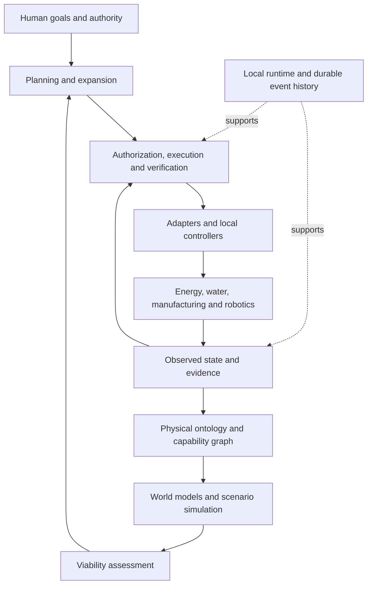

# Poieweave — Autonomous Infrastructure Intelligence

> An open autonomous industrial platform initiated by **Inceptless**.

The name comes from Greek *poiesis* (making) and *autopoiesis* (a system that produces and maintains itself). The project was named **AII** until 2026-10-31; see [ADR-0002](docs/adr/0002-rename-to-poieweave.zh-CN.md).

[](https://github.com/haeliotang/poieweave/actions/workflows/ci.yml)
[](LICENSE)

### Build the open foundation for self-sustaining industrial systems.

**From autonomous machines to autonomous industry. From remote outposts on Earth to the industrial foundations of a multiplanetary civilization.**

Poieweave is a long-horizon research and engineering project toward an open autonomous industrial platform: a system that can represent, simulate, plan, coordinate, and verify the operation, maintenance, production, and eventual expansion of physical infrastructure.

Our central question is simple:

> Can an industrial system preserve and increase its ability to survive, repair, and produce when resources are limited, communications disappear, and equipment keeps wearing out?

**Status: research and architecture stage (Foundation, in progress).** The repository contains the founding documentation, three draft contracts, a structural capability-graph prototype in Rust, and the first structural version of the Autonomous Base-01 scenario. There is no time-domain model, executable platform, validated benchmark, hardware deployment, or implemented integration yet. Unless stated otherwise below, capabilities are design goals.

[中文研究文档 / Research & architecture](docs/research/FOUNDATIONS.zh-CN.md) · [开发文档 / Development plan](docs/DEVELOPMENT.zh-CN.md)

## What exists today

| Artifact | State |
| --- | --- |
| [Physical Ontology](specifications/physical-ontology.zh-CN.md) | v0.3-draft. Units, entities, verification levels, capability-graph semantics (alternative supports, multi-source top-ups, degraded occupation, conservative yield/rework, bounded route enumeration, external-dependency tracing), time-aware state and stock with failure predictions, process instances and scheduling feasibility, energy/power clipping, discrete-event simulation with conservation, and timed scenario verdicts. |
| [State & Action Protocol](specifications/state-action-protocol.zh-CN.md) | v0.2-draft. Record types and envelope, action lifecycle, projection/state versions, dispatch review, ownership and leases, reservations, simulation isolation, append-only persistence, and 11 acceptance cases. Reference implementation: `crates/poie-state`. |
| [Viability & Expansion Contract](specifications/viability-expansion.zh-CN.md) | v0.2-draft. Feasibility queries and six verdict classes, disturbances, four metric groups, reporting and reproduction checklist; reference implementation in `crates/poie-viability`, with the Base-01 v0.2 report generated and checked in CI. |
| [`crates/poie-ontology`](crates/poie-ontology) | Structural prototype: dimensioned quantities, model validation, mass balance, single-ledger capability-graph solver with root-cause reporting, alternative (`requires_any`) supports, multi-source top-ups, a degraded-use occupation policy, conservative yield with explicit reject/rework flows, capability-level verification on top of process-level verification, bounded enumeration of distinct candidate routes, external-dependency tracing across all candidate routes, time-aware status with failure predictions, and earliest-start scheduling feasibility under precedence and unit capacity. |
| [`crates/poie-federation`](crates/poie-federation) | Simulated multi-site federation: per-site logs, hybrid logical clocks, bidirectional log exchange with deduplication and causal ordering, and reconnect reconciliation that reports duplicate idempotency keys, double dispatch, over-reservation and double ownership instead of applying last-write-wins. |
| [`crates/poie-expansion`](crates/poie-expansion) | Expansion accounting: proposal format as a capability-graph increment (construction, commissioning, upkeep, external inputs, bootstrap), structural gain/loss comparison that always reports both lists, and a temporal comparison against the no-expansion baseline with a construction-period service check. |
| [`crates/poie-exec`](crates/poie-exec) | Bounded execution: writable-adapter contract (idempotency, command validity, independent verification sources), an execution gate that only accepts authorized SAP actions and enforces takeover, degradation and key uniqueness, independent verification signals, and a simulated writable adapter with faults (ACK loss, duplicate delivery, crash). |
| [`crates/poie-runtime`](crates/poie-runtime) | Offline shadow runtime: read-only adapter contract (source, units, timestamp semantics, disconnect behaviour; writable adapters rejected), observation records projected with evidence expiry and health checks, shadow planning that records but never dispatches, and prediction reconciliation with censoring. |
| [`crates/poie-plan`](crates/poie-plan) | Deterministic joint planner: priority goals → structural candidates → scheduling → bounded recovery of failed assets; outputs `proposed` actions with preconditions, budgets and validity windows. A SAP validation path runs every action through proposed → validated → authorized and the six dispatch checks, so no plan bypasses authorization. Also non-anticipating replanning with kept/cancelled/added diffs, and three H2 baselines (task priority, safety-stock rule, short-term optimisation). |
| [`crates/poie-process`](crates/poie-process) | Versioned process-model bridge: JSON-line protocol to an isolated Python process, model id/version and unit declarations, wall-clock deadlines that kill the process, and classified failures (timeout, crash, protocol, model mismatch, out-of-validity, non-convergence, numerical failure, conservation, dimension). |
| [`python/poie_models`](python/poie_models/README.md) | Reference process model: a synthetic, uncalibrated steady-state water-treatment model with declared validity ranges and synthetic-data flag, behind the bridge protocol ([ADR-0005](docs/adr/0005-water-process-model.zh-CN.md)); calibration data plan in [DATA.zh-CN.md](python/poie_models/DATA.zh-CN.md). |
| [`crates/poie-viability`](crates/poie-viability) | Viability & Expansion Contract reference: validated feasibility queries, six verdict classes with required attachments, reporting guards that refuse to render `held_on_tested` as safety/robustness or `timeout` as infeasibility, reproducible `sampled`/`enumerated` method plans with seed management, the four metric groups (censored survival times, independence, resilience, sustainability with the anti-cheat pairing), and machine/human reports with the §7 reproduction checklist. |
| [`crates/poie-sim`](crates/poie-sim) | Discrete-event simulator: deterministic `(time, sequence)` event ordering, fixed and state-dependent disturbance trajectories, per-transfer mass-conservation checks with explicit external flows, battery charge/discharge with power/capacity limits and clips, a canonical run digest as the replay basis, and the timed Base-01 runner with committed replay digests. |
| [`crates/poie-state`](crates/poie-state) | State & Action Protocol: the nine record kinds with the common envelope and schema validation; versioned projections with state versions and evidence expiry; the exhaustive action lifecycle table with an idempotency-key dispatch guard (10⁵-sequence property test) and redispatch policy; the six pre-dispatch review checks with traceable rejections; an append-only local log with crash-tail recovery ([ADR-0003](docs/adr/0003-append-only-local-log.zh-CN.md)); restart replay/decisions; and a simulated executor with ACK-loss, duplicate-delivery, NACK and lost-dedup fault injection. SAP-T1–T11 are all automated, including a crash at every persistent write point of the dispatch flow, command ownership/leases with clock-skew detection, partition-safe reservations, and a bridge feeding projected states into capability-graph queries. |
| [Base-01 scenario](scenarios/base-01/README.zh-CN.md) | Structural v0.1 with synthetic data and 40 stratified cases whose expectations were written before the first run. All 40 match. |
| [Base-01 v0.2 VEC report](experiments/vec-base01/report.md) | VEC §7 feasibility report over all 20 pre-registered timed scenarios: `held_on_tested`, counterexamples, in-model infeasibility certificates and one unknown input; the water service level comes from the synthetic `water-treatment` process model (provenance and validity in the report); 78 metric records; validated and replay-checked in CI. |
| [Timed Base-01](scenarios/base-01-timed/README.zh-CN.md) | v0.1 timed scenario: asset/stock timelines with failure predictions, day/night energy and supply interruption; 20 pre-registered cases with a committed replay digest checked in CI. |
| [H1 structural experiment](experiments/h1-structural/PREREG.md) | Pre-registered protocol; 40 stratified cases with a committed 25% holdout; the per-device baseline misses 2/7 blocked holdout cases while the capability-graph solver misses 0/7. H1 is weakly supported, but the conclusion is internal evidence only: the ≥1/4 external-contribution quota is not met and the ground truth was authored with the same model. Details in the [report](experiments/h1-structural/REPORT.md). |
| [Shadow-run demo](experiments/shadow-run/REPORT.md) | Projects the observed field, plans in shadow mode, records actions only (`dispatched=false`), and compares the "would do" plan with a simulated operator log; the shadow guard rejects dispatch. 7/7 assertions, CI replay. |
| [Two-site shadow integration](experiments/two-site-shadow/REPORT.md) | Site A projects field observations and plans; site B shares inventory and leases; over-reservation and overlapping leases block dispatch, a clean reconciliation allows the SAP-validated action through, with independent verification. 7/7 assertions, CI replay. |
| [Localhost TCP federation demo](experiments/federation-tcp/REPORT.md) | Two OS processes exchange records, reservations and leases over real loopback TCP sockets; both sites report the same three expected conflicts (over-reservation, double ownership, duplicate idempotency key). Localhost only — not real multi-site. |
| [End-to-end pipeline demo](experiments/e2e-pipeline/REPORT.md) | Simulated field observation → projection with evidence expiry → joint plan → SAP-validated authorized actions → execution gate (takeover, degradation) → simulated executor → independent verification → prediction check; 9/9 assertions, CI replay. |
| [Base-02 shared depot](scenarios/base-02/model.toml) | Second scenario sharing inventory and a transport truck with Base-01 (heat-treatment workshop); 8 pre-registered structural cases run in CI. |
| [M12.6 simulated partition](experiments/federation-partition/REPORT.sim.md) | Pre-registered simulated partition/reconnect experiment: over-reservation, overlapping leases, duplicate keys and double dispatch are all reported (not silently merged); repeated exchanges are idempotent. **Simulated only** — real multi-node tests remain external. |
| [H4 expansion accounting](experiments/h4-expansion/REPORT.md) | Pre-registered H4 on the Base-01 recycling-furnace proposal: structural gain (`obtain sleeve-p1 4` blocked → candidate, no losses), temporal layer neutral (expansion helps preparation goals, not the service goal), construction-period check passes. Verdict **uncertain** because construction costs are not deducted in the stock model and the external furnace module is not closed; claim capped at `modeled_gain`. |
| [H3 simulated bounded execution](experiments/h3-bounded-execution/REPORT.sim.md) | Pre-registered simulated H3: 14 fault scenarios across two actions; no unregistered duplicate physical actions, duplicate delivery registered, ACK loss/crash reconcile as `outcome_unknown`, network loss/takeover/degradation dispatch nothing. **Simulated only** — the physical testbed is still required for M10 exit. |
| [H2 joint-planning experiment](experiments/h2-joint-planning/REPORT.md) | Pre-registered H2: joint planner vs three baselines on 24 seeded scenarios (16 dev + 8 sealed holdout); all plans SAP-validated. **H2 not supported** (A and baselines tie at 5/8 on holdout); long-horizon ablation is the only clear component. Negative result published with raw outputs. |
| [H1 temporal re-test](experiments/h1-temporal/PREREG.md) | Pre-registered; the time-blind baseline misses 3/7 temporal blockings and 2/5 joint-dependency blockings on the 20 timed cases, while the timed evaluator mismatches 0/20. Internal evidence only. Details in the [report](experiments/h1-temporal/REPORT.md). |

A `candidate` route from the prototype is structural only: it does not check time, capacity, concurrency, or physical execution.

```bash
cargo test
cargo run -p poie-ontology --bin poie-graph -- scenarios/base-01/cases.toml
cargo run -p poie-ontology --bin poie-graph -- scenarios/base-01/cases.toml --routes 3
cargo run -p poie-ontology --bin poie-graph -- scenarios/base-01/cases.toml --external-deps 3
```

## The ambition

A collection of capable robots does not automatically become a capable industrial system. A facility can complete every scheduled task while consuming the spare part, energy reserve, or manufacturing capacity it will need to survive tomorrow.

Poieweave aims to connect energy, water, materials, machines, logistics, maintenance, and production into one accountable operational model. Its objective is to preserve essential services while developing the capacity to recover, replace critical equipment, and reduce external dependencies.

The horizon is a complete autonomous industrial platform. Earth-based microgrids, remote factories, polar stations, and isolated research facilities provide environments in which its foundations can be tested. Lunar and Martian industry extend that horizon; they are not current deployment claims or promised timelines.

We distinguish three frontiers:

1. **Autonomous operation:** sustain essential functions without continuous supervision.
2. **Autonomous maintenance:** diagnose degradation and restore verified capabilities.
3. **Autonomous expansion:** build additional productive capacity within physical, resource, and human-authorized constraints.

Full industrial self-sufficiency remains an open research problem. Poieweave must expose irreducible dependencies, including electronics, precision tools, consumables, and specialist knowledge.

## What we intend to build

| Foundation | Purpose |
| --- | --- |
| **Physical Operational Ontology** | Give assets, resources, processes, capabilities, evidence, actions, and constraints a shared meaning. |
| **Physical Capability Graph** | Represent the joint inputs, equipment, skills, time, and quality requirements needed to produce, repair, or replace something. |
| **Industrial World Model** | Combine conservation laws, process models, discrete events, degradation, and uncertainty into inspectable predictions. |
| **Viability Intelligence** | Estimate which essential services remain feasible, for how long, under explicitly stated disturbances and assumptions. |
| **Planning & Expansion** | Compare production, maintenance, recovery, and construction strategies across competing resource demands. |
| **Execution & Verification** | Turn authorized plans into bounded actions and distinguish requested effects from observed outcomes. |
| **Distributed Runtime** | Retain local facts, policies, models, and decision capability during disconnection, then reconcile evidence safely. |



This is a target architecture, not an implemented system. Device controllers and independent safety interlocks retain authority over physical protection.

## The capability graph

A useful industrial model must express more than “pump P1 belongs to station S1.” It must express:

```text
qualified material + available machine + energy + tooling + validated process
    + operating capability + inspection capacity + time
        -> inspected replacement part
        -> restored equipment
        -> recovered essential service
```

Poieweave will investigate typed, temporal production hypergraphs to represent these joint dependencies. A path through the graph is only a candidate: scheduling, capacity, conservation, quality, and bootstrap dependencies must also be satisfied.

A machine that could theoretically manufacture its own replacement is not self-sufficient if its failure removes the only available means of manufacturing that replacement.

## A different control objective

Task throughput is one outcome. Poieweave's proposed objective is to expand the range of conditions under which infrastructure can continue to provide essential services and recover productive capacity.

We will report separate, physically interpretable dimensions:

- **Viability:** service feasibility over a specified horizon and disturbance set.
- **Independence:** external resource requirements and unresolved critical dependencies.
- **Resilience:** service loss, failure propagation, and recovery time.
- **Sustainability:** material losses, energy balance, equipment depletion, and replenishment capacity.

No opaque universal autonomy score. Every estimate must carry its assumptions, horizon, model versions, uncertainty, and supporting evidence. Simulation success is not proof of physical reliability.

## Rust-first, ecosystem-aware

The proposed language boundary is **Rust for core state and execution semantics; Python for scientific models and optimization; ROS 2/C++ where robotics integration requires it; TypeScript for future interfaces.**

Rust offers a strong basis for explicit types, ownership, concurrency, and long-running local services. It does not by itself guarantee real-time behavior, safe control, or correct physical models. Cross-language integration adds deployment and versioning costs; it also avoids rebuilding mature scientific ecosystems.

We are evaluating the following foundations, with no integration implied:

| Project | Candidate role |
| --- | --- |
| [NASA ISAAC](https://github.com/nasa/isaac) | Reference for autonomous facility caretaking and robotics integration; distinct from NVIDIA Isaac. |
| [Open-RMF](https://openrmf.readthedocs.io/en/latest/) | Fleet task coordination and shared-resource scheduling. |
| [Eclipse BaSyx / AAS](https://eclipse.dev/basyx/) | Standardized asset descriptions and industrial interoperability. |
| [Eclipse Ditto](https://eclipse.dev/ditto/intro-overview.html) | Device twin state and connectivity integration. |
| [IDAES](https://idaes-pse.readthedocs.io/en/stable/) | Equation-oriented process models and optimization. |

[Palantir Ontology](https://www.palantir.com/docs/foundry/ontology/overview) is an architectural reference for connecting operational objects, logic, actions, and permissions. Poieweave's proposed research emphasis is the combination of physical constraints, capability dependencies, local autonomy, and long-term viability. This is not a claim that existing platforms lack related capabilities, and no affiliation is implied.

## Engineering commitments

- **Local autonomy:** essential operation must not require a cloud connection.
- **Physics before persuasion:** models respect units, resource accounting, and explicit validity limits.
- **Evidence before claims:** observations, estimates, predictions, and intentions remain distinct.
- **Simulation before actuation:** hypothetical worlds cannot acquire real device authority.
- **Bounded execution:** commands need preconditions, expiry, authorization, deduplication, and verified outcomes.
- **Human authority:** people define mission priorities, permitted actions, and escalation boundaries.
- **Open interfaces:** models, scenarios, protocols, and decision evidence should be portable and inspectable.

Language models may assist with interpretation and candidate planning. They do not replace physical solvers, authorization checks, or independent protective controls.

## Research roadmap

These are capability gates, not delivery dates. Foundation is in progress; every other stage is planned. Milestones, exit criteria, and current status are tracked in the [development plan](docs/DEVELOPMENT.zh-CN.md).

| Stage | Deliverable | Evidence required to advance |
| --- | --- | --- |
| **Foundation** | Ontology, capability dependencies, event semantics, and a small virtual industrial base. | Unit consistency, resource balance, dependency failure cases, and reproducible replay. |
| **Autonomy** | Joint production, maintenance, and recovery planning. | Fair comparisons against rules and short-horizon optimization; explicit infeasibility and uncertainty. |
| **Embodiment** | Adapters, shadow operation, then bounded execution in a controlled physical testbed. | Observed effects, safe degradation, disconnect/reconnect behavior, and operator recovery. |
| **Expansion** | Planning and verification of additional productive capacity. | Net capability gains after construction, upkeep, inspection, and external inputs are accounted for. |
| **Federation** | Cooperation between independently operable sites. | Local authority survives network partitions; resource commitments and evidence reconcile without duplicate physical actions. |

The first proposed research environment is **Autonomous Base-01**: power, storage, water treatment, a small workshop, logistics and maintenance capability, and a spare-parts inventory. It should expose a complete conceptual loop before accumulating integrations.

The first implementation focus is the ontology and capability graph, exercised by this scenario. We will not create a large empty service hierarchy before the core semantics can be tested.

## Participate

Start with the [founding research document](docs/research/FOUNDATIONS.zh-CN.md). Useful contributions include counterexamples to the capability model, auditable physical models, reproducible failure scenarios, interface proposals, and evidence that challenges our assumptions.

Current evidence for every stage gate and the actions that need external participation are collected in the [stage-gate evidence pack](docs/status/stage-gates.zh-CN.md), the [test and evidence matrix](docs/status/test-matrix.zh-CN.md) and the [external action list](docs/status/external-actions.zh-CN.md). `scripts/verify-all.sh` reproduces every claimed gate.

Use [issues](https://github.com/haeliotang/poieweave/issues) to discuss research questions and scoped implementation proposals. Proposed architecture should earn stability through experiments rather than being treated as a frozen specification.

Read [CONTRIBUTING.md](CONTRIBUTING.md) and the [maintenance runbook](docs/MAINTENANCE.zh-CN.md) before sending a case or a pull request: contributions need a DCO sign-off (`git commit -s`), pre-registered expectations, and must pass the same gates CI runs. Report vulnerabilities privately, as described in [SECURITY.md](SECURITY.md) — not in a public issue.

## Open Source License

Poieweave is released under the **Apache License, Version 2.0**.

The root [LICENSE](LICENSE) applies to the project code and documentation unless otherwise noted. Third-party components retain their own licenses; preserve their notices when redistributing dependencies or binaries.

The proposed open-source boundary is recorded in [ADR-0001](docs/adr/0001-open-source-boundary.zh-CN.md): specifications, the core, and all safety- and authority-relevant semantics stay open; customer-specific adapters, calibrated customer models, and hosted services may be offered separately. The license does not grant trademark rights to the project name.

## Project Origin

Poieweave is initiated by **Inceptless**.

- Initiating Company: Inceptless
- Project: Poieweave — Autonomous Infrastructure Intelligence
- Copyright: (c) 2026 Inceptless.

---

**Build infrastructure that can keep building the future.**
