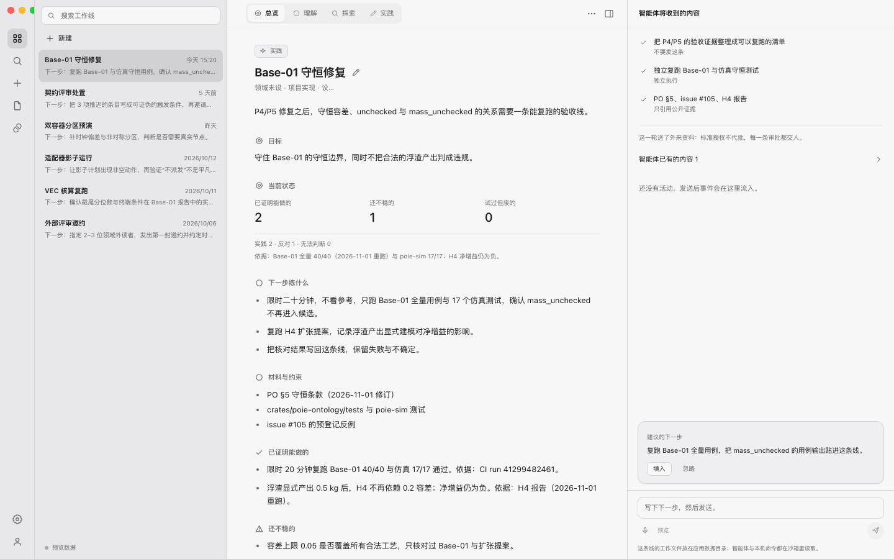

# Poieweave desktop shell

Tauri 2 host + React 19 / TypeScript workline UI. This is the first shell: it
sets up the host boundary (filesystem, SQLite handle, sandbox, packaging) and
the three-pane workline interface, with seeded demo data. It is not yet wired
to the `crates/poie-*` domain crates.



## Stack

- **Host:** `apps/desktop/src-tauri` — Rust, Tauri 2. Owns the app-data
  directory, a bundled SQLite database, a size-limited sandbox, and the bundle
  configuration.
- **Frontend:** `apps/desktop/src` — React 19, TypeScript, Vite 7. No UI
  framework, no web fonts, no remote assets.
- The host crate is **outside the root Cargo workspace** (`Cargo.toml` excludes
  it), so the existing Rust CI and `scripts/verify-all.sh` are unaffected.

## Design

The visual system copies the Inceptless light theme exactly:

| Token | Value |
| --- | --- |
| sidebar | `#e8e8ea` |
| pane | `#f7f7f8` |
| surface | `#efeff1` |
| border / hairline | `#d4d4d8` / `#e3e3e5` |
| ink / muted | `#1a1a1a` / `#666666` |
| accent | `#0369CC` |
| selection | ink at 11% over the sidebar (same as `.nav-line--active`) |

Fonts are the system stack; the three-pane layout is rail + workline list +
document column + agent inspector, with the segmented `总览 / 理解 / 探索 / 实践`
tabs and the agent-context/composer panel from the reference screenshot.
Colours and spacing live in `src/styles.css`; there is no dark theme yet.

## Host commands

| Command | Purpose |
| --- | --- |
| `host_info` | Version, app-data dir, DB path, sandbox root, platform. |
| `notes_all` | Seeded notes from SQLite (`notes.payload` JSON). |
| `events_list` / `event_append` | Per-workline events from the composer. |
| `sandbox_read` / `sandbox_write` | Relative-path, size-limited file access under `<app-data>/sandbox`. |
| `sandbox_root` | The resolved sandbox root. |

Every command goes through the Rust host; the webview never receives SQL or the
sandbox root path except through `host_info`/`sandbox_root`. Path traversal,
absolute paths and oversized files are rejected in `src/sandbox.rs`.

## Run

```bash
cd apps/desktop
pnpm install
pnpm tauri dev        # native window
pnpm dev              # browser-only shell with the seeded JSON fallback
```

## Build

```bash
cd apps/desktop
pnpm build            # tsc + vite build
pnpm tauri build      # .app / .dmg (macOS)
```

## Verify

```bash
cd apps/desktop
pnpm exec tsc --noEmit -p tsconfig.json
pnpm build
cd src-tauri && cargo test --offline   # sandbox and DB unit tests
pnpm tauri build --no-bundle           # host + frontend integration build
```

## Current boundaries

- Demo worklines are seeded from `src/data/notes.json` (shared by the Rust seed
  and the browser fallback). No domain-crate integration yet.
- No theme switching, i18n, authentication, remote inference, or multi-window
  support in this shell.
- The sandbox covers app-data files only; it does not grant arbitrary host file
  access.
- Icons are generated for this app; no Inceptless brand assets are copied.
