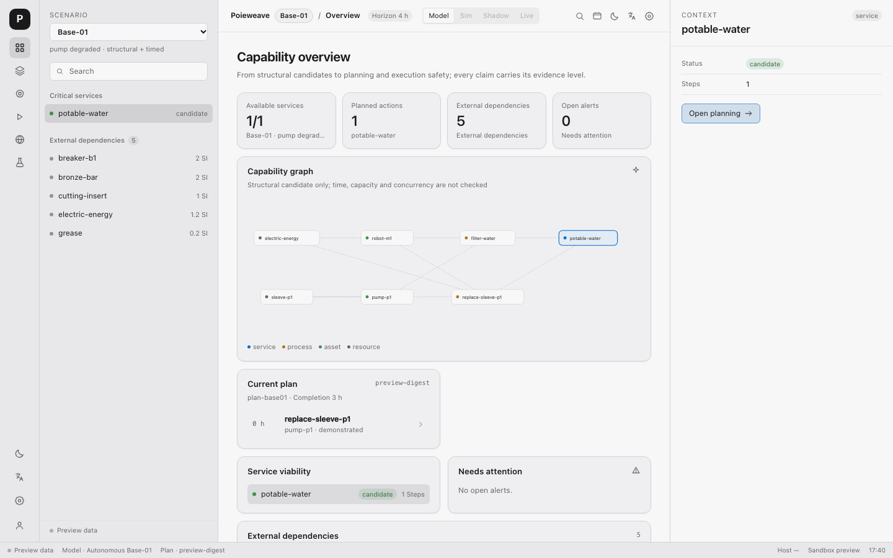
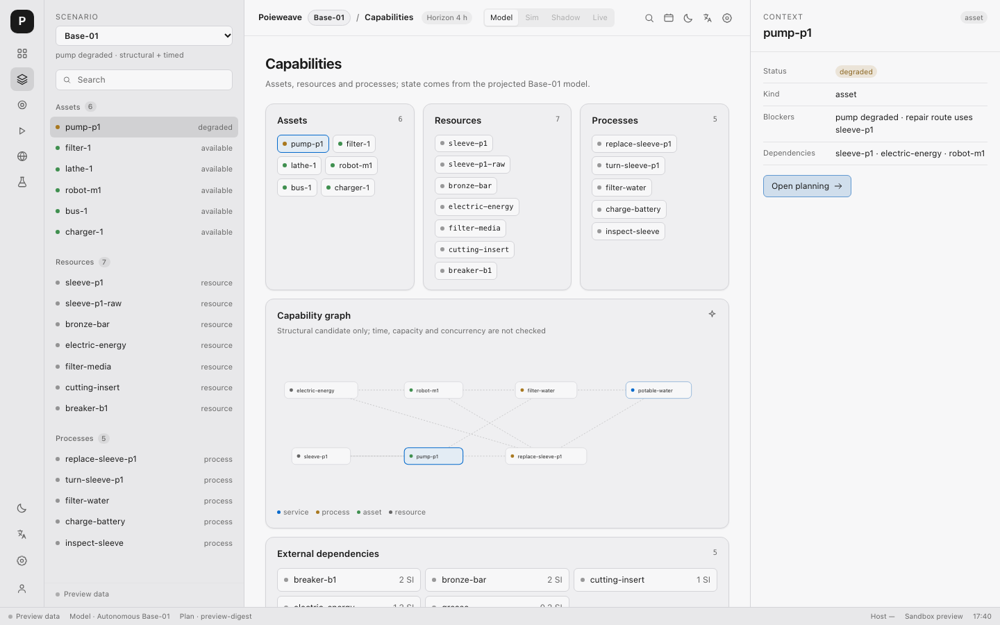
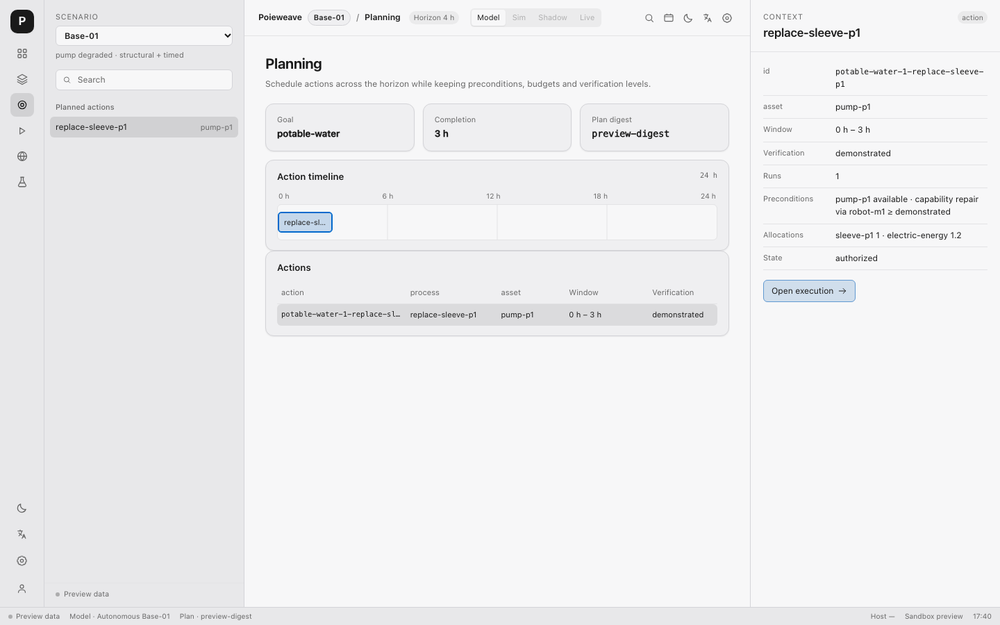
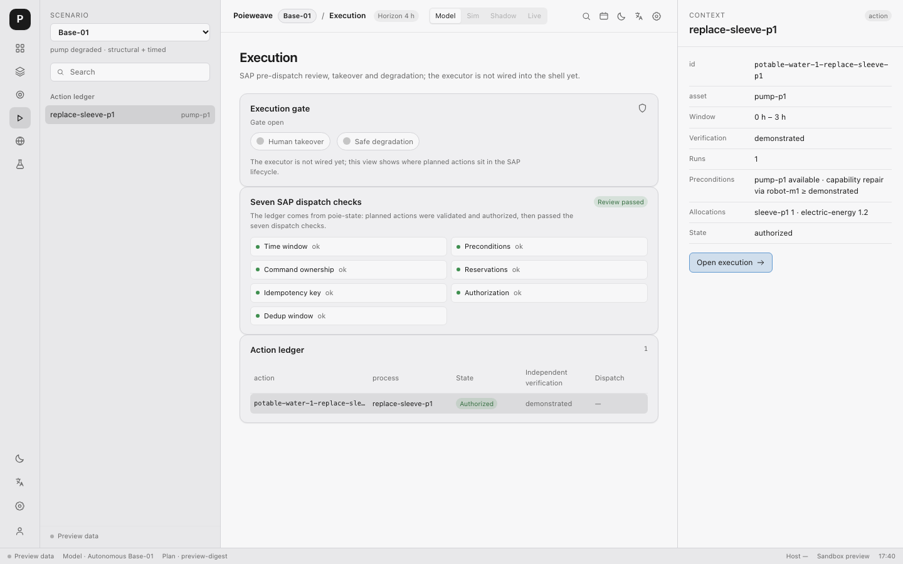
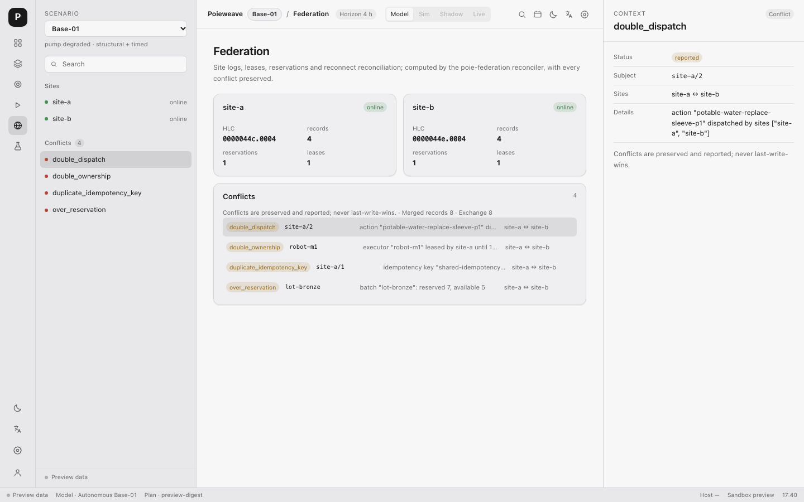
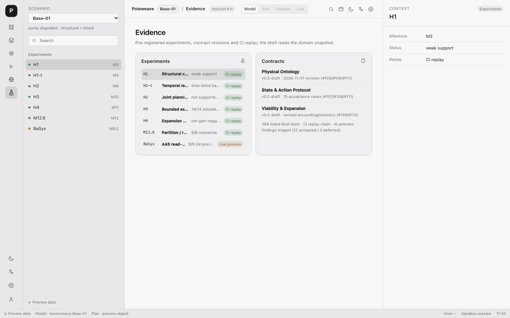
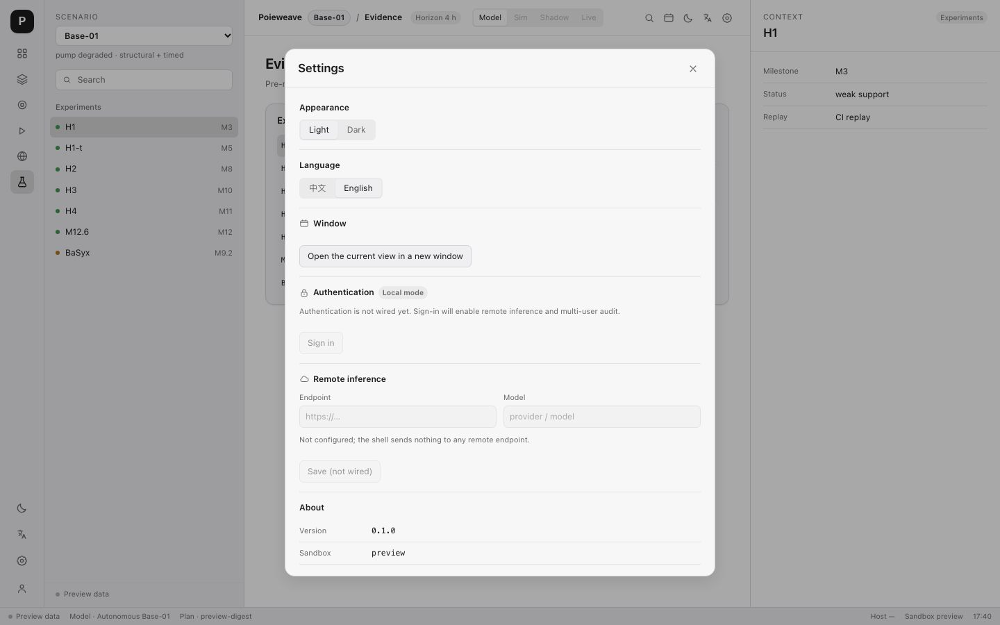
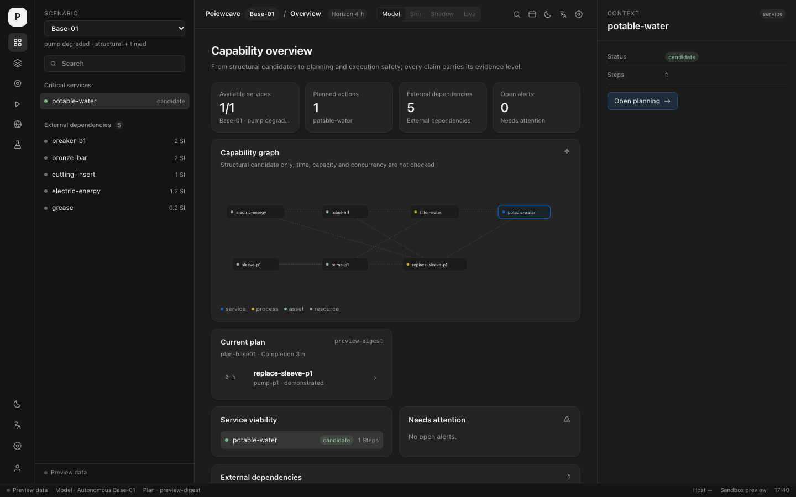
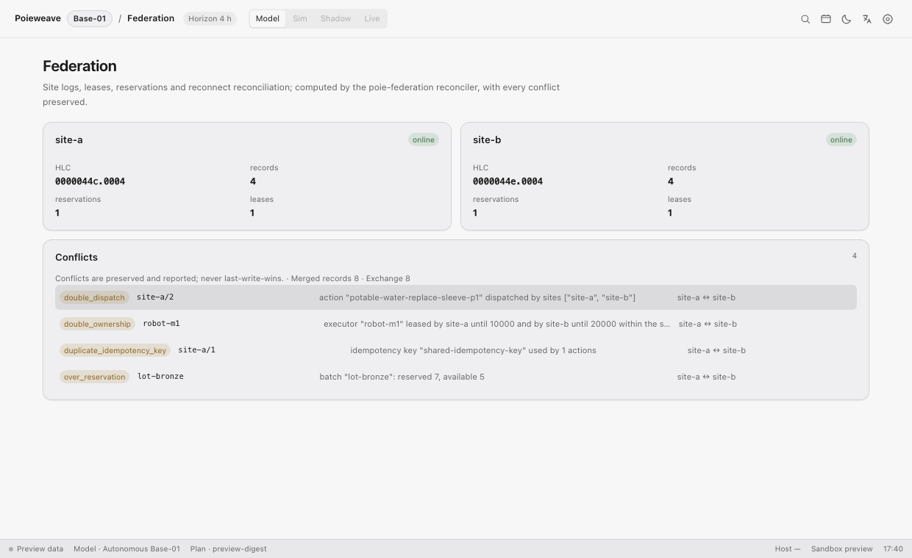

# Poieweave desktop

A Tauri 2 desktop **operations cockpit** for Poieweave: capability graph, planning,
execution gate, federation reconciliation and the evidence chain. The Rust host
owns the app-data directory, SQLite state and a size-limited sandbox; it embeds the
Base-01 model and runs the real `poie-*` domain crates. The frontend is React 19 +
TypeScript + Vite.

## Screens (English UI)

| Overview | Capabilities |
| --- | --- |
|  |  |
| **Planning** | **Execution** |
|  |  |
| **Federation** | **Evidence** |
|  |  |
| **Settings** | **Dark theme** |
|  |  |



This is deliberately **not** a notes/workline layout copied from Inceptless. It
keeps the Inceptless light/dark colour tokens, but the information architecture is
Poieweave's: services → capability entities → plan → SAP execution gate →
federation → evidence.

## Layout

```
rail        64px   Poieweave mark + section icons + theme/language/settings/account
sidebar    288px   scenario, search, contextual entities / actions / conflicts / experiments
workspace  1fr     topbar (scenario, horizon, run mode) + one of six views
inspector  360px   context for the selected service, entity, action, conflict or experiment
statusbar  26px    host, model, plan digest, sandbox, time
```

Views:

| View | Content |
| --- | --- |
| Overview | KPI strip, capability graph, current plan, service viability, external dependencies, open alerts. |
| Capabilities | Assets, resources and processes from the projected Base-01 model, plus the structural graph and external dependencies. |
| Planning | Goal/completion/digest, action timeline and action table; the inspector keeps preconditions, allocations and verification level. |
| Execution | **`poie-state`** action ledger (validated → authorized), the seven SAP dispatch checks, execution gate (human takeover / safe degradation) and the deliberate "executor not wired" warning. |
| Federation | **`poie-federation`** sites (HLC, records, reservations, leases), exchange counts and all preserved reconciliation conflicts. |
| Evidence | Pre-registered experiments with replay badges, contract revisions and the 384-test evidence summary. |

`open_workspace_window` opens focused secondary windows rather than another full
cockpit: federation uses a wide wall, execution an execution monitor, evidence a
reading window. `?view=<view>&focus=1` hides the rail/sidebar/inspector and keeps
the topbar, view and status bar.

## Theme and i18n

- Light and dark tokens are the Inceptless values: light `#e8e8ea / #f7f7f8 /
  #efeff1 / #d4d4d8 / #1a1a1a / #666 / #0369CC`; dark `#141414 / #1c1c1c /
  #242424 / #2e2e2e / #f2f2f2 / #9a9a9a / #0369CC`.
- Theme and language persist in `localStorage`; the language switch covers the
  shell (Chinese/English), while model ids, process names and evidence labels stay
  in their source language.
- No dark-mode colour is invented outside the token block in `src/styles.css`.

## Domain integration

The host embeds the Base-01 model (`scenarios/base-01/model.toml`), patches
`pump-p1` to `degraded`, and runs the real crates:

- `poie-ontology`: graph solve per service + external dependency report;
- `poie-plan`: a 24 h plan for `potable-water` with a 4 h deadline;
- `poie-state`: plan actions become SAP `Action`s, are added to an `ActionLedger`,
  moved to `validated` → `authorized`, and reviewed with `review_dispatch` (all
  seven checks);
- `poie-federation`: two sites exchange logs, then `reconcile` reports duplicate
  idempotency keys, double dispatch, over-reservation and overlapping leases.

Snapshots are computed once at host startup and exposed as serializable commands:

```text
domain_overview       scenario, counts, assets/resources/processes, services,
                      plan, externalDependencies
execution_snapshot    SAP actions with idempotency keys and states, seven checks,
                      review status/rejections
federation_snapshot   sites, conflicts, merged records, exchange counts
```

The browser-only `pnpm dev` build uses the same-shaped preview snapshots in
`src/domain.ts`; the Tauri build replaces them with host results. There is no SQL,
solver, ledger or reconciler access from the webview.

## Host commands

| Command | Purpose |
| --- | --- |
| `host_info` | Version, app-data dir, DB path, sandbox root, platform. |
| `domain_overview` | Base-01 snapshot from `poie-ontology` + `poie-plan`. |
| `execution_snapshot` | `poie-state` ledgers + seven dispatch checks. |
| `federation_snapshot` | `poie-federation` exchange/reconcile snapshot. |
| `notes_all` / `events_list` / `event_append` | SQLite-backed workline data kept for the next integration step. |
| `sandbox_read` / `sandbox_write` / `sandbox_root` | Relative-path, 1 MiB-limited access under `<app-data>/sandbox`; traversal and absolute paths rejected. |
| `open_workspace_window` | Opens a focused secondary window for one of the six views. |

## Authentication and remote inference

The settings sheet exposes both surfaces, but they are **not wired**:

- authentication shows "local mode" and a disabled sign-in button;
- remote inference shows disabled endpoint/model fields and states that no data is
  sent to any remote endpoint.

No fake token, fake login or fake inference call is implemented. The next
iteration should add a host-side credential store (macOS Keychain / Windows
Credential Manager via a Tauri plugin), an inference provider interface and an
audit trail before enabling either surface.

## Run and verify

```bash
cd apps/desktop
pnpm install
pnpm tauri dev            # native window
pnpm dev                  # browser-only cockpit with preview data

pnpm exec tsc --noEmit -p tsconfig.json
pnpm build
cd src-tauri && cargo test --offline    # 8 tests: DB, sandbox, domain, execution, federation
cd .. && pnpm tauri build --no-bundle
```

The desktop crate is excluded from the root Cargo workspace, so the existing
Rust CI and `scripts/verify-all.sh` do not require WebKit.

## Next

1. Wire authentication, the credential store and remote inference with explicit
   opt-in, redaction and audit events.
2. Drive the execution gate from host-side takeover/degraded state instead of the
   local UI toggle.
3. Add site-specific federation windows and an execution monitor window that can
   stay open while the full cockpit changes scenario.
4. Add a host command for replaying an evidence artifact from the desktop shell.
