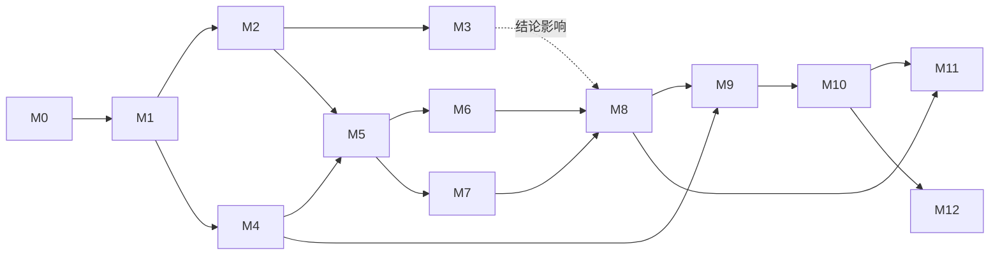

# Poieweave 开发文档：里程碑与工作计划

版本：0.1 / 2026-10-31
适用范围：从 Foundation 到 Federation 的全部开发工作。
依据：[研究纲领](research/FOUNDATIONS.zh-CN.md) §8–§9 · [三份契约](../specifications/) · [Base-01](../scenarios/base-01/README.zh-CN.md)

本文是**能力门槛驱动**的计划，不是排期表。里程碑按依赖关系排序，不写交付日期；只有退出条件全部满足才算完成，不因时间到了就宣布进入下一阶段。

---

## 0. 总览

### 0.1 阶段与里程碑

| 阶段 | 里程碑 | 一句话目标 | 状态 |
| --- | --- | --- | --- |
| Foundation | **M0** 研究基础 | 愿景、问题边界、许可证 | 已完成 |
| | **M1** 契约草案与结构原型 | 三契约 v0.1、能力图原型、Base-01 结构层 | 基本完成（剩 3 项，见 §2.2） |
| | **M2** 本体 v0.2：补齐表达力 | OR 支撑、多来源、降级、合格率、多路线 | 进行中（M2.1–M2.7 完成，仅剩 M2.8 用例补齐） |
| | **M3** H1 结构层实验 | 独立调度基线 + 扩充用例 + 留出集 | 未开始 |
| | **M4** 状态与事件内核 | SAP 参考实现与故障注入 | 未开始 |
| | **M5** 时间维度与 Base-01 v0.2 | 带时间窗的工艺、离散事件仿真、可重放 | 未开始 |
| Autonomy | **M6** 可行性评估 v1 | VEC 参考实现：结论类别、四组指标、报告清单 | 未开始 |
| | **M7** 过程模型桥接 | Python / IDAES 过程模型接入协议 | 未开始 |
| | **M8** 联合规划与 H2 实验 | 生产—维护—恢复联合规划，公平基线与消融 | 未开始 |
| Embodiment | **M9** 适配器与只读影子运行 | 接真实设备数据，只读对比预测与观测 | 未开始 |
| | **M10** 有界执行与 H3 实验 | 受控试验台上的有界动作与恢复 | 未开始 |
| Expansion | **M11** 扩张核算与 H4 实验 | 新增产能的净增益核算 | 未开始 |
| Federation | **M12** 多站点联邦 | 分区下的本地权责与跨站对账 | 未开始 |

### 0.2 依赖关系

可以并行推进的组合：**M2 与 M4**（本体与事件内核互不依赖）；**M3 与 M5**（都依赖 M2，彼此独立）；**M6 与 M7**（M7 只需要 M5 的状态接口）。

### 0.3 阶段门槛（引自研究纲领 §9）

| 阶段门槛 | 必须同时满足 |
| --- | --- |
| Foundation → Autonomy | M1–M5 完成；守恒、依赖反例与重放全部通过；能够描述完整虚拟闭环 |
| Autonomy → Embodiment | M6–M8 完成；公平基线、消融与留出场景齐备；结论和负结果可复现 |
| Embodiment → Expansion | M9–M10 完成；物理反馈验证、故障恢复、现场保护与操作者接管均经过验证 |
| Expansion → Federation | M11 完成；新增能力可实施、可检验，核算后净能力增加；未闭合依赖已列明 |

---

## 1. 开发约定（所有里程碑通用）

### 1.1 仓库结构

目录只在有内容时创建，不提前搭空壳。

| 路径 | 内容 | 出现于 |
| --- | --- | --- |
| `specifications/` | 契约正文（规范性） | M1 |
| `crates/poie-ontology` | 单位、实体、能力图 | M1 |
| `crates/poie-state` | 记录、日志、投影、动作状态机 | M4 |
| `crates/poie-sim` | 离散事件仿真与扰动轨迹 | M5 |
| `crates/poie-viability` | 可行性查询、指标、报告 | M6 |
| `python/poie_models` | 过程模型与优化（Python） | M7 |
| `crates/poie-runtime` | 本地运行时：持久化、派发、恢复 | M9 |
| `adapters/` | 设备与外部系统适配器 | M9 |
| `scenarios/<name>/` | 场景规范、模型、用例、预期 | M1 起 |
| `experiments/<id>/` | 实验登记、清单、原始结果、报告 | M3 起 |
| `docs/adr/` | 架构决策记录 | M1（ADR-0001 开源边界） |
| `docs/progress/` | 进行中工作的任务清单 | M1 起 |

### 1.2 契约的生命周期

| 状态 | 含义 | 变更规则 |
| --- | --- | --- |
| `draft` | 可反驳草案 | 直接修改，在提交说明中写明动机 |
| `candidate` | 至少一个参考实现和一个场景覆盖了全部规范性条款 | 修改需 ADR，并同步更新实现与用例 |
| `stable` | 有两个独立使用方，或经过一个完整阶段的实验 | 只能做向后兼容的修改；破坏性修改需升主版本 |

模式字符串（如 `poie.physical-ontology/0.1`）与契约版本保持一致。加载器必须拒绝不认识的版本。

### 1.3 代码质量门

每次合并前必须满足：

- `cargo fmt --check`、`cargo clippy --all-targets` 无警告、`cargo test` 全部通过，Base-01 用例全部符合预期；
- `cargo deny check licenses bans sources` 通过（依赖许可策略见 ADR-0001 §5）；`advisories` 失败时必须在合并前评估，但不自动阻断无关的 PR；
- 新的规范性行为至少有一个测试，且测试名称能看出它对应契约的哪一条；
- 不引入未在 ADR 或里程碑中说明理由的依赖；
- Python 部分（M7 起）：`ruff`、`mypy --strict`、`pytest`。

### 1.4 实验纪律

1. **预先登记**：用例或实验的预期结论、指标定义、开发集/留出集划分，必须在第一次运行前提交。
2. **结果不符时**：先判断是模型、实现还是预期错了，写下判断依据，再改；不得只改预期让测试变绿。
3. **全部结果**：失败、超时、数值失败、不可行都要保留在报告里。
4. **复现清单**：输入哈希、版本、参数、种子、求解器设置、实际计算消耗（VEC §7）。
5. **声明链接证据**：任何"优于基线""实现自主维护"之类的表述，都要链接到 `experiments/` 中的具体运行。

### 1.5 架构决策记录（ADR）

以下情况必须写 ADR（`docs/adr/NNNN-标题.md`）：引入运行时依赖、改变契约中的规范性条款、拆分进程或服务边界、改变语言分工。内容包括：背景、选项、决定、代价、推翻条件。

### 1.6 工作流程

- 默认分支 `main` 始终可构建、测试全绿。
- 每个里程碑的工作包对应 issue，标签：`milestone:Mx`、`area:ontology|state|sim|viability|models|runtime|adapters|scenario`、`kind:spec|impl|experiment|counterexample`。
- 长时间运行的工作在 `docs/progress/` 下维护任务清单，并随进度更新。

---

## 2. Foundation 阶段

### M0 研究基础 — 已完成

| 交付物 | 位置 |
| --- | --- |
| 愿景与问题边界 | `README.md` |
| 研究纲领与架构审查 | `docs/research/FOUNDATIONS.zh-CN.md` |
| Apache-2.0 许可证与发起方声明 | `LICENSE`、`README.md` |

### M1 契约草案与结构原型 — 基本完成

**目标**：把研究纲领中的核心语义写成可反驳的规范，并用一个最小原型和场景证明这些语义可以执行。

#### 2.1 已完成

| 工作包 | 交付物 | 证据 |
| --- | --- | --- |
| M1.1 Physical Ontology v0.1-draft | `specifications/physical-ontology.zh-CN.md` | — |
| M1.2 State & Action Protocol v0.1-draft | `specifications/state-action-protocol.zh-CN.md` | 含 11 个待实现的故障注入用例 |
| M1.3 Viability & Expansion v0.1-draft | `specifications/viability-expansion.zh-CN.md` | — |
| M1.4 能力图结构原型 | `crates/poie-ontology` | 13 个单元测试 |
| M1.5 Base-01 结构场景 | `scenarios/base-01/` | 11 个预先写定预期的用例全部一致；8 个集成测试 |

原型已实现的规范条款：量纲与单位表（PO §2）、实体与加载校验（§3）、质量守恒（§5）、单一账本求解、循环检测、OR 回溯、验证等级过滤、搜索界限与四类结论（§6）。

#### 2.2 剩余工作

| 工作包 | 内容 | 退出条件 |
| --- | --- | --- |
| M1.6 持续集成 | GitHub Actions（`.github/workflows/ci.yml`）：fmt、clippy、test、Base-01 用例；`cargo-deny`（`deny.toml`）检查许可、禁用项、来源与安全公告。**已完成**：PR #2 合并后 `main` 上 CI 为绿（[run #2](https://github.com/haeliotang/poieweave/actions/runs/41222603966)，2026-10-31）；2026-10-31 本地按同一组命令复跑通过 | CI 在 `main` 上为绿 |
| M1.7 贡献指南 | `CONTRIBUTING.md`：如何提交反例、用例和契约修改；issue 模板（反例 / 契约修改 / 实验提案）；`DCO`、`SECURITY.md`。**已完成**（2026-10-31）：文件全部合并，GitHub 私有漏洞报告已启用 | 文件合并 |
| M1.8 契约外部评审 | 邀请至少一位领域外读者按"能否构造反例"审读三份契约，把问题登记为 issue | 评审意见已登记，并逐条标注接受、拒绝（附理由）或推迟 |
| M1.9 开源边界 | [ADR-0001](adr/0001-open-source-boundary.zh-CN.md)：开放核心 + 六条不变式；配套 `NOTICE`、DCO、`SECURITY.md`、`cargo-deny`。**配套文件已合并**（2026-10-31） | ADR 由 Inceptless 确认为"已接受"；配套文件合并 |
| M1.10 名称落地 | [ADR-0002](adr/0002-rename-to-poieweave.zh-CN.md)：仓库内改名与 GitHub 仓库改名已完成；**商标初步检索已记录**（§7，2026-10-31）：TMview 与 Trademarkia 未发现完全同名标记，残余风险来自 POIE 词根；官方库直连被阻断，类别专项检索待人工复核 | USPTO / EUIPO / CNIPA / WIPO 检索结果记入 ADR-0002 |

**M1 退出条件**：M1.6–M1.10 完成。

### M2 本体 v0.2：补齐表达力

**目标**：解决 Base-01 v0.1 暴露的表达力缺口，使能力图能描述常见的工业冗余和质量现象。

**前置**：M1。

| 工作包 | 内容 | 对应契约条款 |
| --- | --- | --- |
| M2.1 OR 支撑 | `requires_any`：任一支撑资产可用即可（主电源或应急电源）。**已完成**（2026-10-31）：契约 §3.1 / §6.3 规则 9 / §6.4 新增 `no_alternative_support`；实现与 8 个单元测试；Base-01 S11/S12 用例预登记后首次运行即一致 | PO §3.1、§6.3 规则 9（原 §8.3） |
| M2.2 多来源补足 | 一次缺口可由多条替代工艺分别补足一部分。**已完成**（2026-10-31）：契约 §6.3 规则 10；实现先尝试单工艺、再按声明顺序组合；3 个单元测试；Base-01 S13/S14 | PO §6.3 规则 10（原 §8.4） |
| M2.3 降级使用策略 | 策略字段规定哪些资产在 `degraded` 时仍可占用，以及占用的限制。**已完成**（2026-10-31）：契约 §3.1 策略字段、§6.3 规则 11、§6.4 新增 `degraded_restriction`；实现与 6 个单元测试；Base-01 S15/S16 | PO §3.1、§6.3 规则 11（原 §8.2） |
| M2.4 合格率与返工 | 检验工艺可产出合格品与不合格品；支持返工路线；求解按保守合格率分配。**已完成**（2026-10-31）：契约 §3.4 `yield`、§6.3 规则 12；实现按有效产出率规划、废品作为资源记录、返工走普通工艺；4 个单元测试；Base-01 S17/S18 | PO §3.4、§6.3 规则 12（原 §8.7） |
| M2.5 能力本身的验证等级 | 资产对某能力的提供带验证等级（机器人"会换断路器"是否经过演示）。**已完成**（2026-10-31）：契约 §3.6、§6.3 规则 13、§6.4 新增 `capability_below_verification`；实现按能力等级过滤提供者并把能力等级计入路线最低等级；4 个单元测试；Base-01 S19/S20 | PO §3.6、§6.3 规则 13（原 §8.6） |
| M2.6 多候选路线 | 枚举前 k 条结构候选，并输出每条的资源占用、外部依赖与最低验证等级，供后续排序。**已完成**（2026-10-31）：契约 §6.3 规则 14；实现按备选顺序轮换的有界枚举 + 去重 + 逐条汇总，CLI `--routes N`；用例支持 `min_routes` / `max_routes`；2 个单元测试；Base-01 S21/S22 | PO §6.3 规则 14、§8.8 |
| M2.7 外部依赖上溯 | 关键服务的全部候选路线上，列出所有外部依赖（含刀具、量具这类间接依赖）。**已完成**（2026-10-31）：契约 §6.3 规则 15、§6.5 与 VEC §4.2；实现外部依赖报告（候选路线并集 + 无路线时回退阻断根因）、CLI `--external-deps N`；2 个单元测试；Base-01 S23/S24 | PO §6.3 规则 15、§6.5、VEC §4.2 |
| M2.8 Base-01 补充用例 | 为 M2.1–M2.7 各增加至少 2 个预先登记的用例，包括 S3 的应急供电改进版 | — |

**退出条件**：

- 契约升为 Physical Ontology v0.2-draft，§8 中已解决的条目移入正文；
- 每个新条款都有单元测试和至少一个 Base-01 用例；
- 已有 S0–S10 的结论保持不变，或在用例说明中写明结论改变的理由；
- 求解器在 Base-01 全部用例上的运行时间被记录（作为后续规模化的基准，不设阈值）。

**风险**：多候选枚举与多来源补足会让搜索规模指数增长。缓解：先限定 k 和深度，记录 `search_limit` 出现的频率；如需要，在 ADR 中评估转向 CP/SAT 求解。

### M3 H1 结构层实验

**目标**：在结构层检验 H1：联合能力与资源依赖模型能否识别独立设备调度遗漏的恢复阻断条件。

**前置**：M2。

| 工作包 | 内容 |
| --- | --- |
| M3.1 实验登记 | `experiments/h1-structural/PREREG.md`：问题、基线定义、指标（漏判、误判、根因定位正确率）、用例来源、留出集划分，先于任何运行提交 |
| M3.2 独立调度基线 | 实现"逐设备检查"基线：每个工艺只检查自身直接输入与直接占用的资产，不递归、不共享账本 |
| M3.3 用例扩充 | 至少 40 个用例，其中至少 1/4 来自项目作者以外的贡献者；按扰动类型分层（共因、循环、库存竞争、质量门、验证等级、未知状态） |
| M3.4 留出集 | 在开发开始前随机抽出至少 1/4 用例作为留出集，开发期间不得查看结果 |
| M3.5 运行与报告 | 两种方法在全部用例上的结果；按类型给出漏判与误判；列出 Poieweave 方法自身的错误 |

**退出条件**：

- 报告合并到 `experiments/h1-structural/REPORT.md`，附复现清单；
- 无论结果是否支持 H1，都写明结论与局限；不支持时，在 M2 或研究纲领中登记需要修正的模型或方法。

**注意**：结构层的 H1 只是 H1 的一部分。带时间的版本（"母线还能撑 6 小时"）在 M5 之后重复一次。

### M4 状态与事件内核（SAP 参考实现）

**目标**：实现 State & Action Protocol 的核心，使"事实与意图分离""不盲目重试""崩溃可恢复"成为可测试的行为。

**前置**：M1（可与 M2 并行）。

| 工作包 | 内容 | 对应条款 |
| --- | --- | --- |
| M4.1 记录与信封 | 九类记录的类型定义、公共信封、模式版本 | SAP §2.1–2.2 |
| M4.2 只追加日志 | 本地持久化（候选：SQLite，需 ADR）；写入原子性；按场址序号读取 | SAP §1、§5 |
| M4.3 投影与状态版本 | 版本化投影规则；状态版本向量；证据过期降为 `unknown` | SAP §2.3、PO §4 |
| M4.4 动作状态机 | 转移表的穷尽实现；非法转移拒绝；属性测试覆盖任意事件序列 | SAP §3 |
| M4.5 派发前复核 | 六项复核；失败原因可追溯 | SAP §4 |
| M4.6 模拟执行端 | 可注入故障的执行端：ACK 丢失、重复送达、延迟、NACK、重启丢失去重表 | SAP §9 |
| M4.7 崩溃恢复 | 进程在任意写入点被杀后重启，状态与日志一致 | SAP §5 |
| M4.8 仿真隔离 | 命名空间检查；仿真分支无法获得派发权限 | SAP §7 |
| M4.9 与本体对接 | 资产状态由观测投影得到；能力图从投影状态读取输入 | SAP §8 |

**退出条件**：

- SAP-T1 到 SAP-T11 全部实现为自动化测试并通过（T6–T8 的跨场址部分可先用单进程内的两个"场址"模拟）；
- 状态机属性测试：随机生成至少 10⁵ 条事件序列，不出现表外转移，不出现同一幂等键的重复派发；
- 崩溃注入测试覆盖每一个持久写入点；
- SAP 契约升为 v0.2-draft，吸收实现中发现的问题。

**风险**：过早选定存储或网络技术。缓解：M4 只做单机持久化，网络留到 M12；接口与存储实现分离。

### M5 时间维度与 Base-01 v0.2

**目标**：给本体和场景加上时间，使"多久之后会失效""能否来得及修"成为可计算的问题，并建立可重放的仿真。

**前置**：M2、M4。

| 工作包 | 内容 |
| --- | --- |
| M5.1 带时间的状态 | 资产状态与库存随时间变化；预测记录可以表达"某时刻失效"的分布或区间 |
| M5.2 工艺实例与调度可行性 | 工艺有开始时间、时长、资源占用区间；检查设备容量与并发冲突；从结构候选生成时间可行的计划或报告冲突 |
| M5.3 能量与功率 | 光伏发电（依赖时间与天气轨迹）、储能充放电、功率上限 |
| M5.4 离散事件仿真 `poie-sim` | 事件驱动推进；每步守恒核算；扰动轨迹（固定轨迹与状态相关两类，VEC §2.3） |
| M5.5 可重放 | 固定事件顺序、模型版本和种子，可逐位重建状态；浮点比较使用明确容差 |
| M5.6 Base-01 v0.2 | 时间版场景：泵退化速率、母线预测失效、光伏日变化、补给中断；至少 20 个预先登记的时间版用例 |
| M5.7 H1 时间版复测 | 在 M3 的方法上加入时间，重复 H1 实验的子集 |

**退出条件（同时是 Foundation 阶段门槛）**：

- 每次状态转移守恒核算通过，容差按量纲预先规定（研究纲领 §8.3）；
- 任意 Base-01 v0.2 运行可由复现清单逐位重放；
- 依赖正确性覆盖：循环维修、缺少启动资源、共享设备、质量不合格、替代工艺；
- 求解边界区分：可行、已证不可行、超时、数值失败、未知；
- Base-01 v0.2 能描述"能源—生产—损耗—维护—恢复"的完整闭环。

---

## 3. Autonomy 阶段

### M6 可行性评估 v1（VEC 参考实现）

**目标**：回答"在给定扰动下，关键服务能维持多久、能否恢复"，并以契约规定的格式报告。

**前置**：M5。

| 工作包 | 内容 | 对应条款 |
| --- | --- | --- |
| M6.1 查询与结论类别 | 查询字段校验；六类结论；结论表述约束 | VEC §2–3 |
| M6.2 方法：抽样与枚举 | `sampled` 与 `enumerated` 两种方法；种子管理 | VEC §3.2 |
| M6.3 四组指标 | 生存能力（含截尾）、独立性、韧性、可持续性（含防作弊条款） | VEC §4 |
| M6.4 报告与复现清单 | 机读报告 + 人读报告；清单字段齐全 | VEC §7 |
| M6.5 结构层与时域层衔接 | 时域分析中出现违反时，自动调用能力图查询恢复路径 | VEC §3.3 |
| M6.6 集合方法探索 | 评估在小规模 Base-01 上做集合可达或区间界的可行性，结论写入 ADR | VEC §3.2 |

**退出条件**：

- Base-01 v0.2 的全部场景能产生符合契约的报告；
- 有测试保证 `held_on_tested` 不会被渲染成"安全""鲁棒"；超时不会被渲染成不可行；
- 截尾样本存在时不报告均值；
- VEC 升为 v0.2-draft。

### M7 过程模型桥接

**目标**：让 Rust 核心以受控方式调用 Python 科学模型（首选水处理过程），不把求解器的输出直接当成事实。

**前置**：M5（可与 M6 并行）。

| 工作包 | 内容 |
| --- | --- |
| M7.1 桥接协议 | 版本化请求/响应模式：单位、适用范围、截止时间、错误分类、结果摘要；进程隔离 |
| M7.2 水处理过程模型 | 原水泵 + 过滤单元的稳态或简化动态模型（候选 IDAES，需 ADR），声明适用范围 |
| M7.3 结果验证 | 桥接返回值必须经过量纲与守恒检查；超出适用范围时返回 `out_of_validity`，不外推 |
| M7.4 失败处理 | 超时、不收敛、数值失败在可行性报告中分别记录 |
| M7.5 校准数据计划 | 列出可用的公开或授权数据集；未校准的模型在报告中标注 `synthetic` |

**退出条件**：Base-01 的供水服务水平由过程模型计算，而不是常数；桥接的每类失败都有测试；模型适用范围在报告中可见。

### M8 联合规划与 H2 实验

**目标**：实现生产—维护—恢复联合规划，并在公平条件下检验 H2。

**前置**：M6、M7；参考 M3 结论。

| 工作包 | 内容 |
| --- | --- |
| M8.1 规划器 | 从结构候选和时间约束出发的联合规划（候选：MILP/CP，Python 侧，需 ADR）；输出 `proposed` 动作序列，附前提、预算、有效期 |
| M8.2 重规划 | 新观测到达或计划失效时重规划；非预知约束（不能使用未来扰动） |
| M8.3 基线 | 任务优先级策略、带安全库存的规则策略、短期资源优化（VEC §8） |
| M8.4 实验登记 | `experiments/h2-joint-planning/PREREG.md`：扰动分布、计算预算、指标、开发集/留出集 |
| M8.5 消融 | 逐项移除长期时域、退化模型、能力依赖、重规划 |
| M8.6 报告 | 全部运行、种子、失败、超时、不可行、置信区间；负结果同等呈现 |

**退出条件（同时是 Autonomy 阶段门槛）**：

- H2 报告合并，含基线、消融与留出集结果；
- 第三方可以用复现清单重跑并得到相同的结果（在规定容差内）；
- 规划器输出全部经过 SAP 校验路径，不存在绕过授权的接口。

---

## 4. Embodiment 阶段

### M9 适配器与只读影子运行

**目标**：接入真实设备数据，在不发出任何命令的前提下，比较模型预测与现场观测。

**前置**：M8、M4。

| 工作包 | 内容 |
| --- | --- |
| M9.0 合规与边界复核 | 按 ADR-0001 §4.3 判定每个适配器的归属；完成出口管制与行业法规复核 |
| M9.1 适配器契约 | 适配器必须声明：数据来源、单位、时间戳语义、质量标记、断连行为；只读与可写适配器分开 |
| M9.2 首批适配器 | 候选：Eclipse Ditto（设备孪生）、BaSyx/AAS（资产描述）、ROS 2 / Open-RMF（机器人状态）；每个都要在 ADR 中记录版本与兼容性测试结果 |
| M9.3 本地运行时 `poie-runtime` | 长期运行的本地服务：日志、投影、证据过期、健康自检；不依赖云连接 |
| M9.4 影子运行 | 规划器在现场数据上运行，产生的动作只记录不派发；对比"会做什么"与操作者"实际做了什么" |
| M9.5 预测核对 | 退化与服务水平预测与观测对比，记录误差与适用范围外的情况 |
| M9.6 试验台准备 | 选定受控物理试验台（例如小型水泵回路 + 可编程执行器），完成安全评审；保护与急停独立于 Poieweave |

**退出条件**：影子运行持续时间与覆盖的事件类型达到实验登记中预先设定的要求；断连与重连在真实网络上测试过；所有预测误差公开。

### M10 有界执行与 H3 实验

**目标**：在受控试验台上执行有界动作，验证协议在真实故障下的行为（H3）。

**前置**：M9。

| 工作包 | 内容 |
| --- | --- |
| M10.1 可写适配器 | 支持幂等键与命令有效期；不支持的执行端在 ADR 中记录降级方案 |
| M10.2 授权与人工接管 | 授权界面最小实现；操作者随时接管；接管后 Poieweave 只记录不派发 |
| M10.3 独立验证 | 每类动作至少有一个独立于执行端的验证信号 |
| M10.4 H3 实验 | 在规定的崩溃与网络故障模型下注入故障（断电、断网、ACK 丢失、重启），检验无重复物理动作且状态可对账 |
| M10.5 安全降级 | Poieweave 失效时，现场回到原有控制逻辑；验证这一点 |

**退出条件（同时是 Embodiment 阶段门槛）**：H3 报告合并；所有测试过的故障类别中，没有出现重复的物理动作，或者每一次出现都已登记并修复；操作者接管与安全降级经过演练并有记录。

---

## 5. Expansion 阶段

### M11 扩张核算与 H4 实验

**目标**：评估新增生产能力在扣除全部成本后是否带来净增益（H4）。

**前置**：M8、M10。

| 工作包 | 内容 |
| --- | --- |
| M11.1 扩张提案格式 | VEC §6.1 的全部字段；作为能力图增量加载 |
| M11.2 结构层增益 | 在人类给定的目标集合 G 上统计"获得"和"失去"两个列表 |
| M11.3 时域层增益 | 扩张与不扩张两条基线在同一扰动集合上的四组指标，覆盖建造期 |
| M11.4 Base-01 扩张场景 | 候选：第二台维修机器人、切屑回收熔铸、应急直流母线；每个都有建造输入、检验与维护成本 |
| M11.5 H4 实验 | 预先登记；报告净增益为正、为负或不确定的全部情形 |
| M11.6 实物验证 | 至少一项扩张在试验台上实际实施，并按 VEC §6.4 升级声明等级 |

**退出条件（同时是 Expansion 阶段门槛）**：至少一项扩张达到 `demonstrated_gain`；所有提案的"失去"列表和未闭合外部依赖已公开。

---

## 6. Federation 阶段

### M12 多站点联邦

**目标**：多个能独立运行的场址之间协作，网络分区不破坏本地权责。

**前置**：M10。

| 工作包 | 内容 |
| --- | --- |
| M12.1 跨站同步 | 日志交换、HLC、因果排序（候选网络技术需 ADR） |
| M12.2 命令所有权与租约 | SAP §6.1 的完整实现；时钟偏差界 |
| M12.3 跨站库存 | 请求与预留；分区期间的行为 |
| M12.4 重连对账 | 冲突报告；不使用"最后写入胜出"覆盖命令与预留 |
| M12.5 Base-02 | 第二个场景，与 Base-01 共享部分库存与运输能力 |
| M12.6 分区实验 | SAP-T5 到 T8 在真实多节点上复测；长时间分区与反复分区 |

**退出条件（Federation 阶段）**：分区期间没有出现双重控制或超额预留；跨站承诺在重连后全部可对账；结论附复现清单。

---

## 7. 贯穿全程的工作

| 主题 | 持续工作 |
| --- | --- |
| 反例库 | 任何人提交的反例（模型漏判、语义歧义、不守恒）进入 `scenarios/*/cases.toml` 或 issue，并标记来源 |
| 外部依赖清单 | 每个场景维护一份不可本地生产的资源、工具、知识清单，随里程碑更新 |
| 标准映射 | AAS 子模型、Ditto features 与本体的映射说明，随适配器推进而具体化 |
| 安全与权责 | 每次新增可写接口都要复核：仿真隔离、授权范围、现场保护独立性 |
| 文档同步 | README 的"What exists today"表、本文的状态列、契约版本号，在每个里程碑结束时更新 |

---

## 8. 风险登记

| 风险 | 影响 | 缓解 | 触发重新评估的信号 |
| --- | --- | --- | --- |
| 本体过度抽象 | 语义越来越通用却说不清具体问题 | 每个新概念必须先由一个用例驱动 | 新增字段没有对应用例 |
| 场景由作者自造，偏向自身方法 | 实验结论无效 | 外部贡献用例配额、留出集、预先登记 | 外部用例的结果明显差于内部用例 |
| 搜索与规划规模爆炸 | 只能处理玩具规模 | 记录 `search_limit` 频率；适时切换到 CP/SAT/MILP | `search_limit` 超过用例的一成 |
| 过早冻结接口 | 后期修改代价高 | 契约三级生命周期（§1.2） | 尚无实验支撑就要求 `stable` |
| 跨语言集成成本 | 版本漂移、部署复杂 | 桥接协议版本化、进程隔离、ADR 记录每个依赖 | 桥接故障占失败案例的主要部分 |
| 仿真与现场差距 | 仿真结论不能迁移 | 影子运行、预测核对、声明等级 | 影子运行中预测误差持续超出范围 |
| 范围蔓延 | 基础未稳就扩功能 | 研究纲领 §11 的暂停规则 | 守恒、重放或基线公平性任一失守 |

研究纲领 §11 的规则在这里同样适用：**如果模型不守恒、基线比较不公平、状态证据无法重建，或者现场反馈无法确认，就暂停扩展能力，先修复相应的基础。**

---

## 9. 近期待办（可直接开 issue）

按建议顺序排列，括号内为所属工作包。

1. 确认 ADR-0001 开源边界（M1.9）：`NOTICE` 已添加（2026-10-31），ADR 状态待发起方确认
2. 完成 Poieweave 商标检索（M1.10）
3. ~~合并 CI 配置并确认 `main` 上为绿（M1.6）~~ 已完成
4. ~~编写 `CONTRIBUTING.md`（含 DCO）、`SECURITY.md` 与三类 issue 模板（M1.7）~~ 已完成
5. 实现 `requires_any`，并为 S3 增加应急供电改进版用例（M2.1、M2.8）
6. 实现多来源补足（M2.2）
7. 起草 `poie-state` 的记录类型与动作状态机，先写转移表的属性测试（M4.1、M4.4）
8. 起草 `experiments/h1-structural/PREREG.md`，在扩充用例之前提交（M3.1）
9. 发起三份契约的外部评审（M1.8）

---

## 10. 文档修订记录

| 版本 | 日期 | 变更 |
| --- | --- | --- |
| 0.1 | 2026-10-31 | 初版：M0–M12 里程碑、阶段门槛、开发约定、风险登记 |
| 0.1.1 | 2026-10-31 | 加入 M1.9 开源边界（ADR-0001）与 M9.0 合规复核 |
| 0.1.2 | 2026-10-31 | 项目由 AII 改名为 Poieweave（ADR-0002）；crate、包与模式字符串前缀改为 `poie` |
| 0.1.3 | 2026-10-31 | M1.6 持续集成完成：`main` 上 CI 为绿 |
| 0.1.4 | 2026-10-31 | M1.7 贡献指南完成；M1.9 配套文件（`NOTICE`、`DCO`、`SECURITY.md`）合并 |
| 0.1.5 | 2026-10-31 | M1.10 商标初步检索记入 ADR-0002 §7（官方库直连受限，类别专项检索待复核） |
| 0.1.6 | 2026-10-31 | M2.1 OR 支撑完成：`requires_any` 进入 PO §3.1/§6.3/§6.4、实现与 Base-01 S11/S12 |
| 0.1.7 | 2026-10-31 | M2.2 多来源补足完成：PO §6.3 规则 10、实现与 Base-01 S13/S14 |
| 0.1.8 | 2026-10-31 | M2.3 降级使用策略完成：PO §3.1 策略、§6.3 规则 11、实现与 Base-01 S15/S16 |
| 0.1.9 | 2026-10-31 | M2.4 保守合格率与返工完成：PO §3.4 `yield`、§6.3 规则 12、实现与 Base-01 S17/S18 |
| 0.1.10 | 2026-10-31 | M2.5 能力验证等级完成：PO §3.6、§6.3 规则 13、实现与 Base-01 S19/S20 |
| 0.1.11 | 2026-10-31 | M2.6 多候选路线枚举完成：PO §6.3 规则 14、有界枚举与 CLI `--routes`、Base-01 S21/S22 |
| 0.1.12 | 2026-10-31 | M2.7 外部依赖上溯完成：PO §6.3 规则 15、§6.5、VEC §4.2、CLI `--external-deps`、Base-01 S23/S24 |
