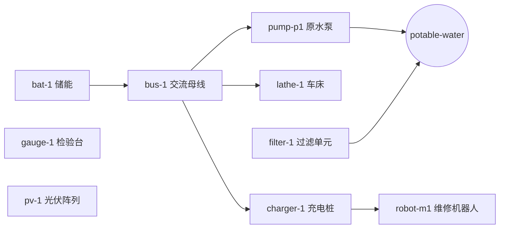

# 场景规范：Autonomous Base-01（结构层 v0.1）

版本：0.2 / 2026-10-31（M2 表达力用例 S11–S24）
依据：[Physical Ontology v0.3-draft](../../specifications/physical-ontology.zh-CN.md) §6 · [研究纲领](../../docs/research/FOUNDATIONS.zh-CN.md) §8

## 1. 目的

Base-01 是 Poieweave 的第一个研究环境。它用最少的实体，覆盖"能源—生产—损耗—维护—恢复"的完整闭环，用来检验能力图的语义是否站得住。

本版只做**结构层**：给定当前资产状态和库存，判断关键服务能否找到一条资源上不冲突的恢复路线；如果找不到，指出根因。时间、容量、并发和随机故障不在本版范围（见 §6）。

**所有数值都是合成假设**，用于检验语义，不代表任何真实设备。

## 2. 文件

| 文件 | 内容 |
| --- | --- |
| [`model.toml`](model.toml) | 基础模型：资源、资产、库存、工艺、服务 |
| [`cases.toml`](cases.toml) | 40 个用例：对基础模型的补丁、查询目标、**运行前登记的**预期结论与根因，以及用于 M3 分层的 `tags`。S0–S10 为基础模型用例；S11–S12 为 M2.1 的替代支撑（OR）用例；S13–S14 为 M2.2 的多来源补足用例；S15–S16 为 M2.3 的降级使用策略用例；S17–S18 为 M2.4 的保守合格率与返工用例；S19–S20 为 M2.5 的能力验证等级用例；S21–S22 为 M2.6 的多候选路线枚举用例；S23–S24 为 M2.7 的外部依赖上溯用例；S25–S39 为 M3.3 的分层扩充用例 |

运行：

```bash
cargo run -p poie-ontology --bin poie-graph -- scenarios/base-01/cases.toml
```

可在命令后追加用例编号，只运行指定用例（如 `S2 S3`）。用例同时由 `cargo test` 中的 `crates/poie-ontology/tests/base01.rs` 执行。

## 3. 组成

### 3.1 资产与支撑关系



箭头表示"被依赖 → 依赖者"（`requires`）。`pv-1` 在 v0.1 中没有被任何工艺使用，因为光伏充电需要时间维度。

| 资产 | 初始状态 | 提供的能力 |
| --- | --- | --- |
| pump-p1 | `degraded`（振动表明轴套磨损） | — |
| robot-m1 | `available` | sleeve-replacement、machine-tending、material-handling、lathe-repair、electrical-repair |
| gauge-1 | `available` | dimensional-inspection |
| 其余 | `available` | — |

robot-m1 是唯一的维修机器人。这是有意的设计：Base-01 要暴露单点依赖，而不是掩盖它。

能力本身也带验证等级（PO §3.6）：基础模型给 robot-m1 的 `sleeve-replacement` 与 `material-handling` 声明 `verified`，`machine-tending`、`lathe-repair`、`electrical-repair` 声明 `demonstrated`。未声明的能力按 `declared` 处理，因此会过滤掉要求更高等级的查询。

### 3.2 工艺

| 工艺 | 作用 | 验证等级 | 关键输入 | 占用 / 能力 |
| --- | --- | --- | --- | --- |
| replace-sleeve-p1 | 恢复 pump-p1 | verified | 轴套 1、润滑脂 0.05 kg、电能 0.5 kWh | sleeve-replacement |
| turn-sleeve-p1 | 加工轴套毛坯 | demonstrated | 青铜棒 1.2 kg、刀片 1、电能 2 kWh | lathe-1 / machine-tending |
| inspect-sleeve-p1 | 质量门：毛坯 → 合格轴套 | verified | 毛坯 1、电能 0.1 kWh | gauge-1 / material-handling |
| replace-lathe-nut | 恢复 lathe-1 | demonstrated | 车床螺母 1、电能 0.3 kWh | lathe-repair |
| turn-lathe-nut | 加工车床螺母 | modeled | 青铜棒 0.4 kg、刀片 1、电能 1 kWh | lathe-1、gauge-1 / machine-tending |
| replace-bus-breaker | 恢复 bus-1 | demonstrated | 断路器 1、电能 0.2 kWh | electrical-repair |

六个工艺全部通过质量守恒校验：切屑、旧件、磨损刀片作为输出显式建模；装进泵体的润滑脂和新旧轴套的质量差用 `asset_mass_change` 记账。

### 3.3 库存

电能 40 kWh；合格轴套 1 件；**隔离**轴套 1 件（缺供应商证书，不可分配）；青铜棒 3 kg；润滑脂 1 kg；刀片 4 片；断路器 1 个；车床螺母 0 个。

### 3.4 外部依赖

模型中没有本地生产工艺的资源：`breaker-b1`、`bronze-bar`、`cutting-insert`、`electric-energy`、`grease`。

其中 `electric-energy` 被列为外部依赖，是因为 v0.1 没有光伏发电工艺，而不是因为基地真的缺乏发电能力。v0.1 中储能是一份固定预算。

## 4. 用例（运行前登记）

预期结论和根因写在 `cases.toml` 中，并在第一次运行前写定。以后新增用例应当先提交预期、再运行。若结果与预期不符，应当先判断是模型错了、求解器错了，还是预期本身错了，并记录判断依据，而不是直接修改预期。

| 编号 | 扰动 | 目标 | 预期结论 | 预期根因 |
| --- | --- | --- | --- | --- |
| S0 | 无 | 供水 | candidate | 使用备件更换轴套 |
| S1 | 合格备件为 0 | 供水 | candidate | 加工 → 检验 → 更换；隔离批次不被使用 |
| S2 | 合格备件为 0，车床故障 | 供水（≥ modeled） | blocked | `cycle` lathe-1 |
| S3 | 母线故障 | 供水 | blocked | `cycle` bus-1 |
| S4 | 泵状态证据过期 | 供水 | unknown | `unknown_state` pump-p1 |
| S5 | 合格备件为 0，加工路线仅 declared | 供水 | blocked | `below_verification` turn-sleeve-p1 |
| S6 | 合格备件为 0，青铜棒 1 kg | 供水 | blocked | `missing_resource` bronze-bar |
| S7 | 合格备件为 0，刀片为 0 | 供水 | blocked | `missing_resource` cutting-insert |
| S8 | 无 | 获得 2 个轴套 | candidate | 1 个用库存，只加工 1 个 |
| S9 | 无 | 获得 4 个轴套 | blocked | `missing_resource` bronze-bar（需 3.6 kg，有 3 kg） |
| S10 | 合格备件为 0，电能 2 kWh | 供水 | blocked | `missing_resource` electric-energy（路线共需 2.6 kWh） |
| S11 | 母线故障，充电桩改为「主母线或应急馈线」 | 供水 | candidate | 经应急馈线修复 bus-1，再更换轴套 |
| S12 | 同 S11，但应急馈线也故障 | 供水 | blocked | `cycle` bus-1；`asset_unavailable` emergency-bus |
| S13 | 青铜棒仅够加工 1 个毛坯，另有 1 个预成型毛坯 | 获得 3 个轴套 | candidate | 库存 1 + 加工 1 + 预成型 1，两条来源各补一部分 |
| S14 | 同 S13，但要求 4 个轴套 | 获得 4 个轴套 | blocked | `missing_resource` bronze-bar；`missing_resource` sleeve-blank |
| S15 | 车床降级，策略允许 `turn-lathe-nut` 占用 1 次 | 获得 1 个车床螺母 | candidate | 不修复车床，直接降级占用（步骤标出） |
| S16 | 同 S15，但要求 2 个螺母 | 获得 2 个车床螺母 | blocked | `degraded_restriction` lathe-1（上限 1 次） |
| S17 | 检验合格率 50%，青铜棒 2 kg | 获得 1 个轴套 | blocked | 一半合格率需 2 个毛坯、2.4 kg 青铜；`missing_resource` bronze-bar |
| S18 | 无青铜、无毛坯，但有 2 个检验废品 | 获得 1 个轴套 | candidate | 废品返工成毛坯（2 次）→ 50% 检验（2 次）→ 1 个合格品 |
| S19 | 机器人的 `sleeve-replacement` 仅 `declared` | 供水（≥ demonstrated） | blocked | `capability_below_verification` sleeve-replacement（工艺是 verified，但能力等级不够） |
| S20 | 同 S19，但能力等级为 `modeled`，查询只要 `modeled` | 供水（≥ modeled） | candidate | 路线最低等级为能力的 `modeled`，而非工艺的 `verified` |
| S21 | 无库存轴套，加工路线与预成型毛坯两条来源 | 获得 1 个轴套 | candidate（≥ 2 条路线） | 两条不同结构路线，各自带消耗、外部依赖与最低等级 |
| S22 | 基础模型，备件更换 | 供水 | candidate（仅 1 条路线） | 只有一条结构路线，枚举不得虚构 |
| S23 | 同 S21 的双来源，查询供水服务 | 供水 | candidate | 外部依赖取两条路线的并集：bronze-bar、cutting-insert、sleeve-blank、grease、electric-energy |
| S24 | 无库存轴套、无刀片 | 供水 | blocked | 无候选路线时回退到阻断根因，仍报告 `cutting-insert` 为外部依赖 |
| S25 | 库存 1 个轴套 + 青铜 1.2 kg | 获得 2 个轴套 | candidate | 库存 1 + 加工 1 |
| S26 | 青铜仅 1.1 kg | 获得 2 个轴套 | blocked | `missing_resource` bronze-bar |
| S27 | 唯一备件批次被隔离 | 供水 | candidate | 只能加工 + 检验 |
| S28 | 备件报废且无刀片 | 供水 | blocked | `missing_resource` cutting-insert |
| S29 | 车削仅 declared，门槛 verified | 供水 | blocked | `below_verification` turn-sleeve-p1 |
| S30 | 车削 verified，机器人 machine-tending 仅 demonstrated | 供水 | blocked | `capability_below_verification` machine-tending |
| S31 | 车床故障且无螺母 | 恢复车床 | blocked | `cycle` lathe-1 |
| S32 | 母线故障且无断路器备件 | 供水 | blocked | `cycle` bus-1；`missing_resource` breaker-b1 |
| S33 | 过滤单元状态未知 | 恢复过滤单元 | unknown | `unknown_state` filter-1 |
| S34 | 母线状态未知 | 供水 | unknown | `unknown_state` bus-1 |
| S35 | 车床健康 | 获得 1 个车床螺母 | candidate | `turn-lathe-nut` |
| S36 | 车床降级，策略允许 2 次占用 | 获得 2 个车床螺母 | candidate | `turn-lathe-nut`（降级占用 2 次） |
| S37 | 直接请求 5 kg 青铜（库存 3 kg） | 获得 5 kg 青铜 | blocked | `missing_resource` bronze-bar |
| S38 | 库存 1 + 青铜 3 kg（可加工 2 个） | 获得 3 个轴套 | candidate | 库存 1 + 加工 2 |
| S39 | 母线故障、充电桩有应急馈线、无断路器备件 | 供水 | blocked | `missing_resource` breaker-b1 |

S11/S12 是 M2.1（替代支撑 `requires_any`）的用例：基础模型保持 v0.1 不变，应急馈线 `emergency-bus` 与充电桩的支撑关系只在该用例的补丁中出现。S11 是 S3 暴露的共因循环的改进版，S12 是同一改进的反例（两个替代都不可用）。

未特别注明时，最低验证等级为 `demonstrated`。

### 4.1 2026-10-31 首次运行结果

11 个用例全部与运行前写定的预期一致；首次运行后只改进了报告文字（显示路线上已分配的量、去除重复的上下文行），没有修改任何预期。这只说明求解器在这 11 个人工构造的用例上，和本规范的语义判断一致。它**不**证明 H1，原因见 §5。

S11/S12 于同日随 M2.1 加入，预期同样在第一次运行前写定，首次运行即与预期一致（S11 路线包含 `replace-bus-breaker` 与 `replace-sleeve-p1`；S12 报告 `cycle` bus-1 与 `asset_unavailable` emergency-bus 两个根因）。

S13/S14 随 M2.2 加入：S13 的两条来源都只能补一部分（青铜棒只够 1 次车削，预成型毛坯只有 1 件），由求解器组合补足 2 个缺口；S14 请求 4 个轴套，总产能只有 3 个，必须报告两条来源各自的阻断原因。两者首次运行即与预期一致，用例中的 `add_resource` / `add_lot` / `add_process` 只在该用例内生效，基础模型不变。

S15/S16 随 M2.3 加入：车床降级后，策略允许 `turn-lathe-nut` 占用它、上限为 1 次。S15 只需 1 个螺母，因此无需先修复车床，路线中该步骤标记为"降级占用"；S16 需要 2 个螺母，第二次占用被拒绝并报告 `degraded_restriction`。两者首次运行即与预期一致。

S17/S18 随 M2.4 加入：用例内的检验工艺声明 50% 的保守合格率，废品作为独立资源 `sleeve-p1-reject` 记录。S17 说明按 1:1 规划会得到错误结论——青铜只够 1 次车削，合格品需要 2 次，因此 `blocked`；S18 说明废品可以经返工工艺变回毛坯，路线为"返工 2 次 → 检验 2 次 → 1 个合格品"，`candidate`。两者首次运行即与预期一致。

S19/S20 随 M2.5 加入：把 robot-m1 的 `sleeve-replacement` 能力等级分别改为 `declared` 与 `modeled`。S19 在 `demonstrated` 门槛下被拒绝（工艺虽是 verified，能力证据不足）；S20 在 `modeled` 门槛下通过，且路线的最低等级正确显示为能力的 `modeled`。两者首次运行即与预期一致。

S21/S22 随 M2.6 加入：S21 给 "获得 1 个轴套" 增加第二条来源（预成型毛坯），枚举得到两条不同路线，每条都带资源消耗、外部依赖与最低验证等级；S22 说明基础供水只有一条结构路线，枚举不会凭空造出更多。两者首次运行即与预期一致。运行时可加 `--routes N` 查看枚举结果。

S23/S24 随 M2.7 加入：S23 把双来源场景用于供水服务，外部依赖报告对两条路线取并集（加工路线贡献 bronze-bar、cutting-insert，预成型路线贡献 sleeve-blank，两条都消耗 grease 与 electric-energy）；S24 在无候选路线时回退到阻断根因，仍报告缺失的外部刀片。两者首次运行即与预期一致。运行时可加 `--external-deps N` 查看上溯结果。

S25–S39 随 M3.3 加入，用于 H1 实验的分层（`tags`）。首次运行发现并修正了 3 处**预期错误**（预期本身写错，不是模型错）：S31/S35 原用 `demonstrated` 门槛，但 `turn-lathe-nut` 的验证等级是 `modeled`，故门槛改为 `modeled`；S37 原请求 1 kg 青铜（库存 3 kg 已满足，应为 `candidate`），改为 5 kg 以暴露外部依赖。修正理由记录于此；留出集此时尚未选定，不涉及留出集。

### 4.2 分层统计（M3.3）

| tags | 用例数 |
| --- | --- |
| `stock-contention` | 14 |
| `other` | 7 |
| `common-cause` | 5 |
| `verification` | 5 |
| `quality-gate` | 4 |
| `unknown` | 3 |
| `cycle` | 2 |

分层标签由场景加载器校验（未知标签或缺少标签会拒绝加载）。

## 5. 与研究假设 H1 的关系

> H1：联合能力与资源依赖模型能够识别独立设备调度遗漏的恢复阻断条件。

S2 和 S3 是 H1 想要捕捉的典型情形：

- **S2**：分开看，"机器人能修车床"和"车床能加工螺母"都成立。合起来，加工螺母需要的正是已经故障的车床。
- **S3**：分开看，"断路器有备件"和"机器人能换断路器"都成立。合起来，机器人依赖的充电桩接在同一条故障母线上。

但 v0.1 还**不能**检验 H1，因为：

1. 还没有实现"独立设备调度"基线，也就无法在同一组用例上比较两种方法的漏判和误判；
2. 用例是由同一作者构造的，可能偏向本模型的长处；
3. 没有时间维度，无法表达"母线还能撑 6 小时"这类更常见的情况。

要检验 H1，需要：实现基线、扩充用例（包括由他人提出的反例）、并在开发前划定留出集。这些列在开发文档的 M2 里程碑中。

## 6. 本版发现的设计问题

S3 揭示了一个结构性弱点：**唯一的维修机器人通过充电桩依赖唯一的母线**，所以母线故障在本模型内无法自主恢复。

可能的改进方向（尚未评估）：

- 充电桩或机器人增加由储能直接供电的应急回路；这需要本体支持 OR 支撑（"任一电源即可"），见 Physical Ontology §8。**本体侧已于 M2.1 支持 `requires_any`，S11/S12 演示了效果；基础模型 v0.1 仍保留单一母线，以继续暴露该弱点。**
- 增加第二台具备 electrical-repair 能力、且不依赖 bus-1 的执行者；
- 把"人工介入"建模为一种显式的、有成本和延迟的外部能力，而不是隐含的兜底。

这正是 Base-01 的用途：在投入硬件之前，先在模型里暴露这类依赖。

## 7. 不在本版范围

| 未覆盖 | 计划 |
| --- | --- |
| 时间、工艺时长约束、并发与设备容量 | v0.2：带时间窗的工艺实例 |
| OR 支撑的模型化（`requires_any`） | 原型已支持；基础模型 v0.1 暂不使用，见 S11/S12 与 Physical Ontology §3.1 |
| 降级使用策略（`occupiable` / `allowed_processes` / `max_occupations`） | 原型已支持；基础模型 v0.1 未声明策略，见 S15/S16 与 Physical Ontology §3.1、§6.3 规则 11 |
| 光伏发电与充放电功率 | v0.2，与时间维度一起 |
| 随机故障、退化速率 | 时域可行性阶段（VEC §2） |
| 随机合格率与统计置信 | 原型只支持确定性期望合格率与返工路线（Physical Ontology §3.4、§6.3 规则 12）；概率版本留待 VEC 时域层 |
| 候选路线排序 | 明确不属于本契约；原型只做有界枚举与逐条汇总（PO §6.3 规则 14、§8.8） |
| 外部依赖的价格、供货周期与供应链风险 | 目前只上溯"哪些资源没有本地生产"（PO §6.3 规则 15、VEC §4.2）；成本与可得性属于后续阶段 |
| 操作者技能衰减、工具磨损 | 能力等级已支持（PO §3.6、§6.3 规则 13）；技能衰减与磨损尚未建模 |
| 水量、水质等服务水平 | VEC §4 服务指标 |
