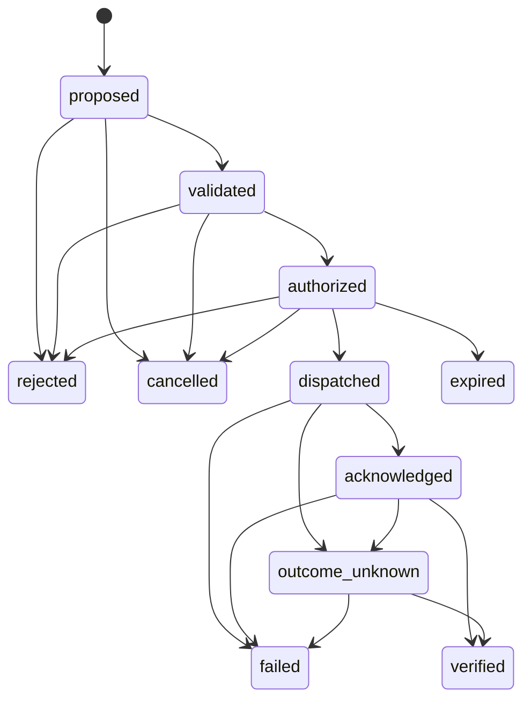

# Poieweave 契约二：State & Action Protocol（状态与行动协议）

版本：0.2-draft / 2026-10-31（2026-11-01 修订：幂等键占用与重派、DUPLICATE 回执、去重窗口绑定有效期、租约纪元与接管规则，见 issue #107、#108；状态标识含求值时刻、序号不得复用与 `sequence_collision`、预留随动作生命周期释放，见 issue #111）
状态：可反驳草案。M4 已完成参考实现 `crates/poie-state`，覆盖 §2.1–2.2 记录信封与九类记录、§2.3 版本化投影与状态版本、§3 动作状态机（含 10⁵ 序列属性测试与重派策略）、§4 七项派发前复核、§5 只追加持久化（ADR-0003）/重启重放与逐写入点崩溃注入、§6.1 命令所有权与租约（含时钟偏差检测、租约纪元、到期接管）、§6.2 库存预留、§7 仿真隔离、§8 投影状态到本体的桥接、§9 模拟执行端与故障注入；SAP-T1–T15 全部有自动化测试。v0.2 吸收的实现决策见 §11；跨场址日志交换与重连对账（§6.4）按计划留到 M12。

相关契约：[Physical Ontology](physical-ontology.zh-CN.md) · [Viability & Expansion](viability-expansion.zh-CN.md)

## 0. 目的与范围

本契约规定 Poieweave 如何记录"知道了什么"和"想做什么、做了什么、结果如何"，以及这些记录在崩溃、消息丢失和网络分区下的行为。

不在本契约范围：底层控制回路、安全联锁与急停（它们保留现场权限，不受 Poieweave 支配）；具体传输协议；用户界面。

规范用语同 Physical Ontology §0.1。

## 1. 原则

1. **事实与意图分离**：观测、估计、预测、期望状态、动作、回执和验证是不同的记录。下发"关闭阀门"不代表阀门已关闭，收到 ACK 也不代表工艺后果已实现。
2. **只追加**：记录一旦写入不得修改或删除；更正以新记录表达，并引用被更正的记录。
3. **本地优先**：每个场址必须能在没有远程连接时记录事实、评估动作并执行已授权的动作。
4. **不盲目重试**：结果不明的动作先确认现场，再决定下一步。
5. **不宣称通用 exactly-once**：本协议通过持久记录、幂等键、接收端去重与现场对账降低重复执行风险，并在已测试的故障模型内给出保证。

## 2. 记录

### 2.1 公共信封

每条记录必须携带：

| 字段 | 含义 |
| --- | --- |
| `record_id` | 全局唯一。建议 `<site>/<seq>`，seq 为该场址日志中单调递增的序号；**已用过的 seq 不得复用**，日志回滚（快照恢复、整段丢失）后也不得复用，见 §5 第 5 条 |
| `kind` | 记录类型，见 §2.2 |
| `subject` | 所涉实体标识（资产、批次、服务、动作） |
| `site` | 写入记录的场址 |
| `source` | 产生内容的来源：传感器、适配器、模型、人员 |
| `event_time` | 所述事件发生的时间（来源时钟） |
| `recorded_time` | 写入本地日志的时间（本地时钟） |
| `hlc` | 混合逻辑时钟值，用于跨场址因果排序 |
| `causes` | 本记录直接依据的记录标识列表 |
| `schema_version` | 记录模式版本 |
| `namespace` | `live` 或仿真分支名，见 §7 |

`event_time` 与 `recorded_time` 不得互相替代。时钟偏差必须作为故障场景测试。

### 2.2 记录类型

| 类型 | 必需的附加字段 | 说明 |
| --- | --- | --- |
| `observation` | 量值或状态、测量不确定度或质量标记 | 来源直接读到的东西 |
| `estimate` | 量值、不确定度、`model_version`、输入记录 | 对当前不可直接观测量的推断 |
| `prediction` | 量值或分布、时域、`model_version`、场景 | 对未来的判断 |
| `desired_state` | 目标值、请求者、有效期 | 想要达到的状态，不是事实 |
| `action` | 见 §3 | 动作的创建 |
| `transition` | `action_id`、`from`、`to`、理由、执行者 | 动作生命周期的一次状态变化 |
| `receipt` | `action_id`、接收方、ACK / NACK / DUPLICATE、原因；DUPLICATE 附 `duplicate_of` | 执行方对命令的回执。ACK：已接收；NACK：执行端声明**未执行**；DUPLICATE：该幂等键此前已被接收（`duplicate_of` 为首次接收它的动作），本次没有再次执行。三者不得混用 |
| `verification` | `action_id`、使用的证据记录、结论、是否自报 | 动作效果是否被确认 |
| `correction` | 被更正的 `record_id`、更正原因 | 更正此前的记录 |

### 2.3 状态是日志的投影

资产状态、库存数量等"当前状态"都是从日志按确定规则投影得到的。

1. 投影规则必须版本化。投影是"记录集合、投影版本、证据策略、**求值时刻 `as_of`**"的函数：给定同一组记录、同一投影版本、同一证据策略和同一 `as_of`，必须得到相同的状态。`as_of` 必须是显式输入，不得隐式读取当前时钟。
2. 每个投影结果携带**状态版本**：参与计算的各场址最大序号向量。状态版本只标识记录集合；同一状态版本在不同 `as_of` 上可以投影出不同状态（证据会过期）。因此投影结果还必须携带**状态标识** = (状态版本，投影版本，证据策略，`as_of`)。凡需要唯一确定"哪一个状态"的引用——包括可复现性哈希与 Viability & Expansion §2.2 的 `initial_state`——都必须引用完整的状态标识，而不是只引用状态版本。
3. 证据过期规则（Physical Ontology §4）在投影中执行：相对 `as_of` 过期的证据支撑的状态投影为 `unknown`。
4. 动作前置条件引用校验时的状态版本；谓词是否成立取决于投影的 `as_of`。派发前复核（§4 第 2 项）必须以派发时刻为 `as_of` 重新投影，因此"校验时有效、派发时已过期"的证据会使谓词不成立。

## 3. 动作

### 3.1 字段

| 字段 | 要求 | 含义 |
| --- | --- | --- |
| `action_id` | 必须 | 唯一标识 |
| `idempotency_key` | 必须 | 执行端去重用的键；同一物理意图的重新下发必须复用该键。占用与复用规则见 §3.4 |
| `redispatch_of` | 重派时必须 | 本动作重新下发的原动作（该键当前的持有者），见 §3.2 补充规则 2、§3.4 |
| `target` | 必须 | 目标资产 |
| `command` | 必须 | 命令内容（由适配器契约解释） |
| `plan_ref` | 应当 | 来源计划及其版本 |
| `policy_version` | 必须 | 校验与授权所依据的策略版本 |
| `precondition` | 必须 | 状态版本 + 谓词列表（如"阀门 V3 为 open""电池储能 ≥ 2 kWh"） |
| `valid_from` / `valid_until` | 必须 | 有效期；过期动作不得派发。租约下 `valid_until` 不得晚于租约到期减偏差界（§6.1 规则 6）；剩余有效期不得超出执行端去重窗口能覆盖的范围（§4 第 7 项） |
| `budget` | 应当 | 预计消耗的资源（Physical Ontology 中的物理量） |
| `reservations` | 可以 | 为本动作锁定的库存批次 |
| `reversibility` | 必须 | `idempotent`（重复执行无额外效果）/ `reversible` / `compensable`（可由另一动作抵消）/ `irreversible` |
| `verification_spec` | 必须 | 确认效果所需的证据：观测谁、什么条件、在多长时间窗口内 |
| `authorization` | 授权后必须 | 授权者、授权依据、授权范围、到期时间 |

### 3.2 生命周期

终态：`verified`、`rejected`、`expired`、`cancelled`、`failed`。
待处置态：`outcome_unknown`，不是终态，必须由检查结果结束。

### 3.3 转移表

| 从 | 到 | 触发 | 守卫条件 |
| --- | --- | --- | --- |
| proposed | validated | 校验器 | 前置谓词在所引用状态版本上成立；预算可由库存满足；不违反本体约束和硬约束 |
| proposed | rejected | 校验器 | 上述任一条件不成立；必须记录原因 |
| validated | authorized | 授权者 | 授权者权限覆盖该目标与命令；策略版本一致；授权未过期 |
| validated | rejected | 授权者 | 拒绝授权 |
| authorized | dispatched | 派发器 | 见 §4 派发前复核 |
| authorized | rejected | 派发器 | 复核发现前置条件已不成立（原因 `stale_precondition`） |
| authorized | expired | 运行时 | 到达 `valid_until` 仍未派发 |
| proposed / validated / authorized | cancelled | 授权者或计划修订 | 尚未派发 |
| dispatched | acknowledged | 执行端回执 | 收到 ACK；或收到 DUPLICATE（该键此前已被执行端接收，本次未再执行；效果仍须验证） |
| dispatched | failed | 执行端回执 | 收到 NACK（执行端声明未执行）。DUPLICATE 不得触发此转移 |
| dispatched | outcome_unknown | 运行时 | 回执超时 |
| acknowledged | verified | 验证器 | `verification_spec` 规定的证据在窗口内出现且满足条件 |
| acknowledged | failed | 验证器 | 证据与预期效果矛盾 |
| acknowledged | outcome_unknown | 运行时 | 验证窗口结束仍无充分证据 |
| outcome_unknown | verified / failed | 验证器 | 查询或现场检查得到证据。后继重派收到的 DUPLICATE 回执可作为"原命令已被执行端接收"的证据引用，但它是执行端自报（§3.2 补充规则 3），不单独构成 `verified` |

不在表中的转移必须被拒绝。

补充规则：

1. **派发后不能"取消"**：已派发动作的物理效果可能已经开始。撤销只能通过一个新的补偿动作表达，并引用原动作。
2. **不从 outcome_unknown 自动重派**：重新执行必须是新的 `action_id`，以 `redispatch_of` 引用该键当前的持有者，并复用原 `idempotency_key`。持有者处于 `outcome_unknown` 时，`irreversible`（以及 `reversible`、`compensable`）动作在检查结果出来之前不得重新派发；"检查结果出来"指验证器已把持有者转为 `verified` 或 `failed`。只有持有者与重派动作都是 `idempotent`、且场址策略允许时，才可在检查前用同一幂等键重派。持有者为 `failed`（含 NACK）时可以重派；为 `verified` 时意图已实现，不得重派；为 `dispatched` / `acknowledged` 时回执或验证仍未决，不得重派。
3. **验证应当独立**：验证证据应当来自执行端以外的来源（例如阀门命令用下游流量计验证）。若唯一证据是执行端自报，`verification` 记录必须标记 `self_reported = true`，规划层不得把它等同于独立验证。

### 3.4 幂等键的占用与复用

本节是幂等键的唯一规则；§3.2 补充规则 2、§4 第 5 项、§6.4 与 §11 均以此为准。

1. **占用**：某动作在本场址派发一个键之后，该键即被占用。占用在 `dispatched`、`acknowledged`、`outcome_unknown`、`verified`、`failed` 中都持续，重启后由日志重放恢复，不因任何状态而释放。
2. **复用**：键被占用时，另一个动作只有同时满足以下条件才能派发同一个键：
   - 它的 `redispatch_of` 指向该键当前的持有者（重派链的末端：已派发该键、且尚未被其他已派发动作重派的那个动作）；
   - 持有者为 `failed`；或持有者为 `outcome_unknown`，双方都是 `idempotent`，且场址策略允许检查前重派。
3. 其余情况一律拒绝，包括：不引用持有者的第二个动作；持有者处于 `dispatched` / `acknowledged` / `verified`；持有者处于 `outcome_unknown` 而重派动作不是 `idempotent` 或策略不允许。
4. 同键重派到达一个仍保留该键的执行端时，只会得到 DUPLICATE 回执，不会再次执行（§4 末段）。若验证已确认原命令执行过、只是效果不足，需要再执行一次，那是新的物理意图，必须使用新键，并在 `causes` 中引用原动作。
5. 键在一个场址内按本节复用；不同场址的动作不得使用同一个键（§6.4 规则 3）。

## 4. 派发前复核

派发器在 `authorized → dispatched` 之前，必须在当前最新状态上再次检查：

1. 当前时间在 `[valid_from, valid_until]` 内；
2. 前置谓词在**当前**状态版本上仍成立（不能只依赖校验时的版本）；
3. 本场址持有目标资产的命令所有权（§6.1）；若所有权是租约，当前时间不晚于 `until − B`，动作的 `valid_until` 也不晚于 `until − B`（B 为偏差界，§6.1 规则 3、6）；租约处于接管待对账状态时（§6.1 规则 4），只允许 `idempotent` 动作；
4. `reservations` 中的库存仍由本动作持有；
5. `idempotency_key` 满足 §3.4：没有被其他动作占用，或本动作是 §3.4 允许的重派；
6. 授权未过期，策略版本未被撤销；
7. 执行端去重窗口覆盖本命令：`valid_until − 当前时间 + B` 不超过执行端声明的去重记录保留时长。执行端未声明保留时长、但自身按下文第 2 条拒绝超出窗口的命令时，此项由执行端承担。

任一不满足即转为 `rejected`，原因必须写明，不得静默等待。

发往执行端的命令必须携带 `idempotency_key` 和 `valid_until`；所有权是租约时还必须携带租约纪元 `lease_epoch`（§6.1 规则 5）。执行端（或其适配器）应当：

1. 对去重窗口内重复的幂等键返回 **DUPLICATE** 回执，附首次接收该键的动作，不重复执行；不得以 NACK 回执重复键。最好同时返回首次执行的结果。
2. 对某键的去重记录，保留时长不短于该命令首次接收时的剩余有效期加偏差界 B。做不到时，拒绝剩余有效期超出其窗口的命令（NACK，未执行）。SAP-T3"只执行一次"以本条为前提。
3. 拒绝已过期的命令（NACK）。
4. 记住见过的最大租约纪元，拒绝纪元更低的命令，以及在见过纪元之后不带纪元的命令（NACK）。

NACK 只用于"执行端没有执行这条命令"。

**降级**：执行端不能按幂等键去重时，不得派发（ADR-0007）。执行端不能检查租约纪元时，只能依靠时间界：命令 `valid_until ≤ until − B`，执行端按自身时钟拒绝过期命令；这要求执行端时钟同样在偏差界内，否则旧持有者的在途命令仍可能在接管后执行，此风险必须随适配器披露。既不能检查纪元、也不能按时钟拒绝过期命令的执行端，不得由租约远程控制，只能由本地所有权控制。

## 5. 崩溃恢复

1. 状态转移必须先持久写入日志，再产生外部效果。派发的顺序是：写 `dispatched` 转移 → 发送命令。
2. 重启后，处于 `dispatched` 且没有回执的动作必须转为 `outcome_unknown`，而不是重新发送。
3. 处于 `authorized` 的动作重启后必须重新执行完整的派发前复核。
4. 处于 `acknowledged` 的动作重启后继续等待验证，验证窗口按原 `event_time` 计算。
5. **序号不复用与回滚检测**：日志可能整段丢失或从旧快照恢复，此时本地日志看不到已经发出、可能已被对端持有的序号与 `dispatched` 记录。为此：
   - 场址应当在日志存储之外持久化本场址的序号高水位，并在重启后从高水位之上继续编号；
   - 重启后、派发任何动作之前，若能联系到对端，场址必须取回对端持有的本场址记录。若发现对端持有的本场址最大 seq 大于本地日志的最大 seq（回滚），必须先补齐这些记录（其中 `dispatched` 且无回执的动作按第 2 条转 `outcome_unknown`），并把高水位提升到该 seq 之上，然后才能派发；
   - 无法联系对端时，场址仍可按 §6.3 在本地记录与派发，但回滚可能未被发现；重连对账必须按 §6.4 第 3 条检测 `sequence_collision`，这是最后一道防线。
## 6. 所有权与网络分区

### 6.1 命令所有权

1. 任一时刻，每个执行器最多由一个场址持有命令所有权。只有持有者可以派发以该执行器为目标的动作。
2. **协商移交**：本地执行器的所有权默认属于本场址。所有权转移必须以记录表达，由让出方先写放弃、接收方后写接收；中间状态下双方都不得派发。放弃记录必须列出让出方在该执行器上尚未结束（`dispatched` / `acknowledged` / `outcome_unknown`）的动作；列出了未结束动作时，接收方按规则 4 处理。
3. **租约与到期接管**：远程持有的所有权必须是**带到期时间 `until` 的租约**。设 B 为每个场址时钟相对参考时间的偏差上界（两场址之间因此最多相差 2B）。持有者在本地时间超过 `until − B` 后必须停止派发。到期接管是协商移交之外的独立路径：不需要放弃记录，但接管方必须等到本地时间超过 `until + B`，在此之前不得接管。两侧各留 B，双方时钟都在界内时不会同时认为自己持有。偏差超出假设上界，或失去比对源、偏差无法确定时，按超界处理，不据此判定租约有效。
4. **接管前对账**：到期接管时，接管方必须取得旧持有者在该执行器上的动作记录（对账），列出其中尚未结束的动作。在这些动作都经检查转为终态之前（或接管方在接管之后取得目标的独立观测并据此处置之前），以及无法取得旧持有者记录时，接管方只能派发 `idempotent` 动作。规则 2 中放弃记录列出未结束动作的情形同样适用本条。
5. **租约纪元**（fencing token）：每次把所有权交给新的持有者（协商移交或到期接管），该执行器的租约纪元单调递增；同一持有者续约不变。命令必须携带派发者的租约纪元，执行端按 §4 末段第 4 条拒绝更低的纪元。
6. 命令的 `valid_until` 不得晚于 `until − B`（§4 第 3 项）。在时间假设成立时，旧持有者的在途命令在接管方开始派发之前就已过期；消息延迟、进程暂停或时钟超界使时间假设失效时，由规则 5 的纪元检查兜底。

### 6.2 库存所有权

1. 库存批次的分配权属于实物所在场址。其他场址只能发出请求，由所在场址写入预留。
2. 同一批次的预留总量不得超过该批次的可用量。网络分区期间，远程请求不得被视为已预留。
3. **预留随动作生命周期变化**：

   | 动作事件 | 预留状态 | 对可用量 |
   | --- | --- | --- |
   | 授权之前至 `acknowledged` | `held` | 计入已占用 |
   | → `verified` | `consumed`：从批次数量中扣除，预留结束 | 扣除 |
   | → `rejected` / `expired` / `cancelled` | `released`：从未派发，没有物理效果 | 归还 |
   | `dispatched → failed`（NACK，执行端声明未执行） | `released` | 归还 |
   | → `outcome_unknown`；`acknowledged → failed`；`outcome_unknown → failed` | `in_doubt`：动作可能已执行，"失败"也不能证明没有消耗 | 继续计入已占用，但必须单独报告 |

   Physical Ontology §3.4 所说"执行后从库存中扣除"，在协议层对应 `verified`。
4. **`in_doubt` 不得静默释放，也不得无限滞留**：策略必须规定 `in_doubt` 的最长滞留时间，超时必须上报人员处置。`in_doubt` 只能这样结束：动作转为 `verified`（按 `consumed` 处理）；或者在该动作命令的 `valid_until` 之后（执行端会拒绝过期命令，不会再执行）对批次做实物盘点，以盘点数量为准并结束 `in_doubt`。在 `valid_until` 之前的盘点不能结束 `in_doubt`。

### 6.3 分区期间

1. 各场址继续记录事实，并在本地所有权范围内校验、授权（若本地有授权者或已委托的策略）、派发动作。
2. 不得为不属于本场址的执行器或库存生成可派发的动作。
3. 依赖远程事实的前置谓词，在证据过期后必须视为不满足。

### 6.4 重连对账

1. 双方交换各自日志中对方缺少的记录；合并后按投影规则重新计算状态。
2. 观测类记录按来源与 `event_time` 合并，不使用"最后写入胜出"覆盖物理命令或预留。
3. 冲突必须显式产生 `conflict` 报告并交由策略或人员处置，至少包括：同一执行器出现两个持有者的动作；同一批次预留超额；同一幂等键被两个场址的动作使用（同一场址内按 §3.4 的重派链复用不算冲突）；**同一 `record_id` 在两处内容不同**（`sequence_collision`：序号被复用，通常是日志回滚的结果，见 §5 第 5 条）。合并时不得按 `record_id` 去重后静默保留任一版本。
4. 分区期间到期的动作保持 `expired`，不得因重连而复活。

## 7. 仿真隔离

1. 仿真分支必须使用独立的 `namespace`。仿真记录不得被投影进 `live` 状态。
2. 仿真分支不得持有命令所有权、租约或授权；它的连接不得具有现场写权限。
3. 求解器和 LLM 只能产出 `proposed` 动作或候选计划，必须经过校验、授权与派发前复核才能进入现场。
4. 从仿真结果生成的现场动作必须引用仿真分支与模型版本，作为证据链的一部分。

## 8. 与 Physical Ontology 的接口

- 资产 `status` 由 `observation` / `estimate` 投影得到；`unknown` 的含义与本体一致。
- 工艺执行在协议层表现为一个或一组动作；工艺的 `inputs` 对应动作的 `budget` 与 `reservations`，`restores` 对应 `verification_spec` 中的资产状态条件。
- 能力图返回的候选路线不是动作；把路线变成动作需要补全前置条件、有效期、授权和验证规格。

## 9. 验收用例（实现时必须覆盖）

| 编号 | 场景 | 期望 |
| --- | --- | --- |
| SAP-T1 | 派发后进程崩溃，未收到 ACK | 重启后为 `outcome_unknown`，不重发 |
| SAP-T2 | ACK 丢失，执行端已执行 | 不重复物理执行；经检查转为 `verified` |
| SAP-T3 | 同一命令消息重复送达执行端 | 执行端按幂等键去重，只执行一次；重复送达得到 DUPLICATE 回执。前提：去重窗口覆盖剩余有效期加 B（§4 第 7 项、§4 末段第 2 条） |
| SAP-T4 | 授权后、派发前前置状态改变 | `rejected`，原因 `stale_precondition` |
| SAP-T5 | 动作在分区期间过期 | 重连后保持 `expired`，不重放 |
| SAP-T6 | 两个场址分区期间试图预留同一批次 | 只有实物所在场址的预留生效；另一方无可派发动作；重连无超额 |
| SAP-T7 | 租约持有者断联至租约到期 | 持有者在 `until − B` 后停止派发；新持有者在 `until + B` 之后经到期接管才可派发，接管前不能以协商移交代替 |
| SAP-T8 | 时钟偏差超过假设上界 | 被检测并报告；不据此判定租约有效 |
| SAP-T9 | 设备重启丢失去重表 | 行为被记录为已知风险；`irreversible` 动作不重派 |
| SAP-T10 | 仅有自报证据 | `verification.self_reported = true`，不计为独立验证 |
| SAP-T11 | 仿真分支尝试派发现场动作 | 被拒绝 |
| SAP-T12 | 旧持有者的不可逆动作处于 `outcome_unknown` 时租约到期并发生接管 | 对账并处置之前，接管方只能派发 `idempotent` 动作；无法对账时同样保守 |
| SAP-T13 | 旧持有者的在途命令在接管后才到达执行端 | 命令 `valid_until` 不超过 `until − B`；即使时间假设失效，执行端也按租约纪元拒绝（NACK），不执行 |
| SAP-T14 | 去重窗口短于命令剩余有效期 | 派发前复核或执行端拒绝该命令；不会出现"窗口外、有效期内"的第二次执行 |
| SAP-T15 | 结果未知后同键重派 | `irreversible` 在检查前被拒，检查后以原键放行；策略允许时 `idempotent` 可在检查前重派；执行端已接收该键时回 DUPLICATE，动作转 `acknowledged` 而不是 `failed`；NACK 后可用原键重试；对账不把同场址重派链报为冲突 |

## 10. 待决问题

1. 去重窗口长度与执行端存储能力的关系。正确性约束（窗口覆盖剩余有效期加 B）已写入 §4 第 7 项与 §4 末段；仍待决的是具体取值，以及不支持幂等键或租约纪元的执行端的降级在真实适配器上是否可行（§4 末段、ADR-0007）。
2. 授权委托：断网时本地策略能自动授权哪些动作，如何限定范围和有效期。
3. 多步工艺的动作分组：部分步骤完成后失败，如何表达"部分完成"并规划恢复。
4. HLC 的偏差上界取值，以及无可靠时钟设备的处理。B 的含义（单站相对参考时间的上界）已在 §6.1 规则 3 写明；M4 实现以可配置常量 `ASSUMED_CLOCK_SKEW_BOUND_MS`（默认 2000 ms）作为假设上界，具体取值、以及失去比对源多久后视为偏差未知，仍需现场数据。
5. 日志压缩与长期存储：只追加日志如何快照而不破坏可重放性。
6. 跨场址识别"同一物理意图"：到期接管时，§6.1 规则 4 只能保守处理旧持有者的未决动作；接管方新建的动作不能复用旧持有者的键（§3.4 第 5 条），因此无法被执行端识别为同一意图。是否需要跨场址的意图标识，留待 M12 对账实践后决定。

## 11. v0.2 吸收的实现决策

M4 的实现暴露了 §1–§9 中未写明、必须由实现决定的行为。以下决定进入 v0.2 草案；若后续证据推翻，按 §1.2 的草案规则修改并记录。

1. **记录模式版本**：`poie.record/0.2` 与本契约版本一致；加载器拒绝未知版本。
2. **幂等键的占用与复用**（2026-11-01 修订，issue #107）：键在 `dispatched` / `acknowledged` / `outcome_unknown` / `verified` / `failed` 中都保持占用，重启后不释放；只能通过 §3.4 的重派链复用（`redispatch_of` 指向当前持有者；持有者 `failed`，或 `outcome_unknown` 且双方 `idempotent` 且策略允许）。原条文"`failed` 不释放键、重派复用原键"与 §4 第 5 项互相矛盾，原实现让 §3.2 允许的重派永远走不通，已由本条取代。
3. **重启后的动作**：`dispatched` 一律转 `outcome_unknown` 且不重发；`authorized` 必须重做 §4 的七项复核；`acknowledged` 继续等待验证，窗口按原 `event_time`。（§5.2–5.4）
4. **租约的时钟保守性与 fencing**（2026-11-01 修订，issue #108）：B 为单站相对参考时间的偏差上界。持有者在 `until − B` 之后停止派发；到期接管方等到 `until + B` 之后，且只能通过到期接管路径（不能以普通授予代替）；命令 `valid_until ≤ until − B`；每换一次持有者租约纪元加一，命令携带纪元，执行端拒绝更低的纪元；到期接管在对账旧持有者的未决动作之前只允许 `idempotent` 动作。偏差超出假设上界时报 `clock_skew`，不把租约判为有效。（§6.1 规则 2–6）
5. **预留的场址性**：只有实物所在地写入预留；远程请求在重连后由所在地应用，且与本地预留受同一上限约束。（§6.2）
6. **日志格式**：JSON Lines 单文件、逐条 `write_all` + `sync_data`、场址序号严格递增；打开时只截断尾部残行，中间损坏必须报错。从对端学到的本场址序号高水位持久化在日志旁的 `<log>.hwm` 文件中，之后的追加必须超过它（§5 第 5 条）；该文件与日志同介质，整盘回滚时仍可能一并丢失，此时依靠对账的 `sequence_collision`。见 ADR-0003。
7. **T9 的已知风险**：执行端重启丢失去重表时，重复送达可能导致重复物理执行；协议层通过"不自动重派 + 结果检查后才允许重派"降低风险，但无法消除执行端侧风险。该风险必须随适配器实现一并披露。
8. **未实现范围**：跨场址日志交换、HLC 因果排序与重连对账（§6.4）留到 M12；当前参考实现是单进程、单写入者的本地内核。
9. **回执三分**（2026-11-01 修订，issue #107）：回执分 ACK / NACK / DUPLICATE。DUPLICATE 驱动 `dispatched → acknowledged`，不得驱动 `failed`。回执记录以可选字段 `duplicate_of` 表达 DUPLICATE（`ack = true` 且带 `duplicate_of`；NACK 不得带 `duplicate_of`），记录模式版本仍为 `poie.record/0.2`，旧记录照常可读。动作新增可选字段 `redispatch_of`，同样不改变模式版本。
10. **去重窗口与有效期**（2026-11-01 修订，issue #107）：派发前复核第 7 项检查 `valid_until − now + B` 不超过执行端声明的保留时长；模拟执行端对剩余有效期超出窗口的命令回 NACK 而不执行。可写适配器声明新增 `dedup_window_ms` 与 `supports_lease_epoch`（ADR-0007）。
