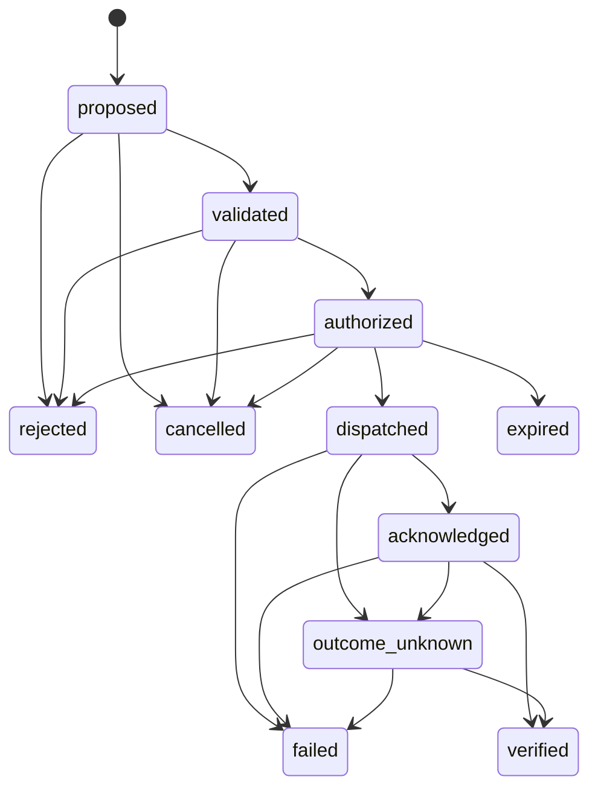

# Poieweave 契约二：State & Action Protocol（状态与行动协议）

版本：0.1-draft / 2026-10-31
状态：可反驳草案。v0.1 尚无参考实现；状态机与故障注入用例列在 §9，作为后续实现的验收依据。

相关契约：[Physical Ontology](physical-ontology.zh-CN.md) · [Viability & Expansion](viability-expansion.zh-CN.md)

## 0. 目的与范围

本契约规定 Poieweave 如何记录"知道了什么"和"想做什么、做了什么、结果如何"，以及这些记录在崩溃、消息丢失和网络分区下的行为。

不在本契约范围：底层控制回路、安全联锁与急停（它们保留现场权限，不受 Poieweave 支配）；具体传输协议；用户界面。

规范用语同 Physical Ontology §0.1。

## 1. 原则

1. **事实与意图分离**：观测、估计、预测、期望状态、动作、回执和验证是不同的记录。下发"关闭阀门"不代表阀门已关闭，收到 ACK 也不代表工艺后果已实现。
2. **只追加**：记录一旦写入不得修改或删除；更正以新记录表达，并引用被更正的记录。
3. **本地优先**：每个场址必须能在没有远程连接时记录事实、评估动作并执行已授权的动作。
4. **不盲目重试**：结果不明的动作先确认现场，再决定下一步。
5. **不宣称通用 exactly-once**：本协议通过持久记录、幂等键、接收端去重与现场对账降低重复执行风险，并在已测试的故障模型内给出保证。

## 2. 记录

### 2.1 公共信封

每条记录必须携带：

| 字段 | 含义 |
| --- | --- |
| `record_id` | 全局唯一。建议 `<site>/<seq>`，seq 为该场址日志中单调递增的序号 |
| `kind` | 记录类型，见 §2.2 |
| `subject` | 所涉实体标识（资产、批次、服务、动作） |
| `site` | 写入记录的场址 |
| `source` | 产生内容的来源：传感器、适配器、模型、人员 |
| `event_time` | 所述事件发生的时间（来源时钟） |
| `recorded_time` | 写入本地日志的时间（本地时钟） |
| `hlc` | 混合逻辑时钟值，用于跨场址因果排序 |
| `causes` | 本记录直接依据的记录标识列表 |
| `schema_version` | 记录模式版本 |
| `namespace` | `live` 或仿真分支名，见 §7 |

`event_time` 与 `recorded_time` 不得互相替代。时钟偏差必须作为故障场景测试。

### 2.2 记录类型

| 类型 | 必需的附加字段 | 说明 |
| --- | --- | --- |
| `observation` | 量值或状态、测量不确定度或质量标记 | 来源直接读到的东西 |
| `estimate` | 量值、不确定度、`model_version`、输入记录 | 对当前不可直接观测量的推断 |
| `prediction` | 量值或分布、时域、`model_version`、场景 | 对未来的判断 |
| `desired_state` | 目标值、请求者、有效期 | 想要达到的状态，不是事实 |
| `action` | 见 §3 | 动作的创建 |
| `transition` | `action_id`、`from`、`to`、理由、执行者 | 动作生命周期的一次状态变化 |
| `receipt` | `action_id`、接收方、ACK / NACK、原因 | 执行方对命令的回执 |
| `verification` | `action_id`、使用的证据记录、结论、是否自报 | 动作效果是否被确认 |
| `correction` | 被更正的 `record_id`、更正原因 | 更正此前的记录 |

### 2.3 状态是日志的投影

资产状态、库存数量等"当前状态"都是从日志按确定规则投影得到的。

1. 投影规则必须版本化。给定同一组记录、同一投影版本，必须得到相同的状态。
2. 每个投影结果携带**状态版本**：参与计算的各场址最大序号向量。动作的前置条件引用这个版本。
3. 证据过期规则（Physical Ontology §4）在投影中执行：过期证据支撑的状态投影为 `unknown`。

## 3. 动作

### 3.1 字段

| 字段 | 要求 | 含义 |
| --- | --- | --- |
| `action_id` | 必须 | 唯一标识 |
| `idempotency_key` | 必须 | 执行端去重用的键；同一物理意图的重新下发必须复用该键 |
| `target` | 必须 | 目标资产 |
| `command` | 必须 | 命令内容（由适配器契约解释） |
| `plan_ref` | 应当 | 来源计划及其版本 |
| `policy_version` | 必须 | 校验与授权所依据的策略版本 |
| `precondition` | 必须 | 状态版本 + 谓词列表（如"阀门 V3 为 open""电池储能 ≥ 2 kWh"） |
| `valid_from` / `valid_until` | 必须 | 有效期；过期动作不得派发 |
| `budget` | 应当 | 预计消耗的资源（Physical Ontology 中的物理量） |
| `reservations` | 可以 | 为本动作锁定的库存批次 |
| `reversibility` | 必须 | `idempotent`（重复执行无额外效果）/ `reversible` / `compensable`（可由另一动作抵消）/ `irreversible` |
| `verification_spec` | 必须 | 确认效果所需的证据：观测谁、什么条件、在多长时间窗口内 |
| `authorization` | 授权后必须 | 授权者、授权依据、授权范围、到期时间 |

### 3.2 生命周期

终态：`verified`、`rejected`、`expired`、`cancelled`、`failed`。
待处置态：`outcome_unknown`，不是终态，必须由检查结果结束。

### 3.3 转移表

| 从 | 到 | 触发 | 守卫条件 |
| --- | --- | --- | --- |
| proposed | validated | 校验器 | 前置谓词在所引用状态版本上成立；预算可由库存满足；不违反本体约束和硬约束 |
| proposed | rejected | 校验器 | 上述任一条件不成立；必须记录原因 |
| validated | authorized | 授权者 | 授权者权限覆盖该目标与命令；策略版本一致；授权未过期 |
| validated | rejected | 授权者 | 拒绝授权 |
| authorized | dispatched | 派发器 | 见 §4 派发前复核 |
| authorized | rejected | 派发器 | 复核发现前置条件已不成立（原因 `stale_precondition`） |
| authorized | expired | 运行时 | 到达 `valid_until` 仍未派发 |
| proposed / validated / authorized | cancelled | 授权者或计划修订 | 尚未派发 |
| dispatched | acknowledged | 执行端回执 | 收到 ACK |
| dispatched | failed | 执行端回执 | 收到 NACK（执行端声明未执行） |
| dispatched | outcome_unknown | 运行时 | 回执超时 |
| acknowledged | verified | 验证器 | `verification_spec` 规定的证据在窗口内出现且满足条件 |
| acknowledged | failed | 验证器 | 证据与预期效果矛盾 |
| acknowledged | outcome_unknown | 运行时 | 验证窗口结束仍无充分证据 |
| outcome_unknown | verified / failed | 验证器 | 查询或现场检查得到证据 |

不在表中的转移必须被拒绝。

补充规则：

1. **派发后不能"取消"**：已派发动作的物理效果可能已经开始。撤销只能通过一个新的补偿动作表达，并引用原动作。
2. **不从 outcome_unknown 自动重派**：重新执行必须是新的 `action_id`，引用原动作，并复用原 `idempotency_key`。对 `irreversible` 动作，在检查结果出来之前不得重新派发。对 `idempotent` 动作，策略可以允许在检查前用同一幂等键重派。
3. **验证应当独立**：验证证据应当来自执行端以外的来源（例如阀门命令用下游流量计验证）。若唯一证据是执行端自报，`verification` 记录必须标记 `self_reported = true`，规划层不得把它等同于独立验证。

## 4. 派发前复核

派发器在 `authorized → dispatched` 之前，必须在当前最新状态上再次检查：

1. 当前时间在 `[valid_from, valid_until]` 内；
2. 前置谓词在**当前**状态版本上仍成立（不能只依赖校验时的版本）；
3. 本场址持有目标资产的命令所有权（§6.1）；
4. `reservations` 中的库存仍由本动作持有；
5. `idempotency_key` 在本地没有处于 dispatched / acknowledged / verified 的其他动作；
6. 授权未过期，策略版本未被撤销。

任一不满足即转为 `rejected`，原因必须写明，不得静默等待。

发往执行端的命令必须携带 `idempotency_key` 和 `valid_until`。执行端（或其适配器）应当在去重窗口内拒绝重复的幂等键，拒绝已过期的命令，并以 NACK 回执说明原因。

## 5. 崩溃恢复

1. 状态转移必须先持久写入日志，再产生外部效果。派发的顺序是：写 `dispatched` 转移 → 发送命令。
2. 重启后，处于 `dispatched` 且没有回执的动作必须转为 `outcome_unknown`，而不是重新发送。
3. 处于 `authorized` 的动作重启后必须重新执行完整的派发前复核。
4. 处于 `acknowledged` 的动作重启后继续等待验证，验证窗口按原 `event_time` 计算。

## 6. 所有权与网络分区

### 6.1 命令所有权

1. 任一时刻，每个执行器最多由一个场址持有命令所有权。只有持有者可以派发以该执行器为目标的动作。
2. 本地执行器的所有权默认属于本场址。所有权转移必须以记录表达，由让出方先写放弃、接收方后写接收；中间状态下双方都不得派发。
3. 远程持有的所有权必须是**带到期时间的租约**。租约到期且无法续约时，持有者必须停止派发；租约到期前不得被其他场址接管。时钟偏差界必须计入到期判断。

### 6.2 库存所有权

1. 库存批次的分配权属于实物所在场址。其他场址只能发出请求，由所在场址写入预留。
2. 同一批次的预留总量不得超过该批次的可用量。网络分区期间，远程请求不得被视为已预留。

### 6.3 分区期间

1. 各场址继续记录事实，并在本地所有权范围内校验、授权（若本地有授权者或已委托的策略）、派发动作。
2. 不得为不属于本场址的执行器或库存生成可派发的动作。
3. 依赖远程事实的前置谓词，在证据过期后必须视为不满足。

### 6.4 重连对账

1. 双方交换各自日志中对方缺少的记录；合并后按投影规则重新计算状态。
2. 观测类记录按来源与 `event_time` 合并，不使用"最后写入胜出"覆盖物理命令或预留。
3. 冲突必须显式产生 `conflict` 报告并交由策略或人员处置，至少包括：同一执行器出现两个持有者的动作；同一批次预留超额；同一幂等键在两个场址都被派发。
4. 分区期间到期的动作保持 `expired`，不得因重连而复活。

## 7. 仿真隔离

1. 仿真分支必须使用独立的 `namespace`。仿真记录不得被投影进 `live` 状态。
2. 仿真分支不得持有命令所有权、租约或授权；它的连接不得具有现场写权限。
3. 求解器和 LLM 只能产出 `proposed` 动作或候选计划，必须经过校验、授权与派发前复核才能进入现场。
4. 从仿真结果生成的现场动作必须引用仿真分支与模型版本，作为证据链的一部分。

## 8. 与 Physical Ontology 的接口

- 资产 `status` 由 `observation` / `estimate` 投影得到；`unknown` 的含义与本体一致。
- 工艺执行在协议层表现为一个或一组动作；工艺的 `inputs` 对应动作的 `budget` 与 `reservations`，`restores` 对应 `verification_spec` 中的资产状态条件。
- 能力图返回的候选路线不是动作；把路线变成动作需要补全前置条件、有效期、授权和验证规格。

## 9. 验收用例（实现时必须覆盖）

| 编号 | 场景 | 期望 |
| --- | --- | --- |
| SAP-T1 | 派发后进程崩溃，未收到 ACK | 重启后为 `outcome_unknown`，不重发 |
| SAP-T2 | ACK 丢失，执行端已执行 | 不重复物理执行；经检查转为 `verified` |
| SAP-T3 | 同一命令消息重复送达执行端 | 执行端按幂等键去重，只执行一次 |
| SAP-T4 | 授权后、派发前前置状态改变 | `rejected`，原因 `stale_precondition` |
| SAP-T5 | 动作在分区期间过期 | 重连后保持 `expired`，不重放 |
| SAP-T6 | 两个场址分区期间试图预留同一批次 | 只有实物所在场址的预留生效；另一方无可派发动作；重连无超额 |
| SAP-T7 | 租约持有者断联至租约到期 | 持有者停止派发；到期后新持有者才可派发 |
| SAP-T8 | 时钟偏差超过假设上界 | 被检测并报告；不据此判定租约有效 |
| SAP-T9 | 设备重启丢失去重表 | 行为被记录为已知风险；`irreversible` 动作不重派 |
| SAP-T10 | 仅有自报证据 | `verification.self_reported = true`，不计为独立验证 |
| SAP-T11 | 仿真分支尝试派发现场动作 | 被拒绝 |

## 10. 待决问题

1. 去重窗口长度与执行端存储能力的关系；执行端不支持幂等键时的降级方案。
2. 授权委托：断网时本地策略能自动授权哪些动作，如何限定范围和有效期。
3. 多步工艺的动作分组：部分步骤完成后失败，如何表达"部分完成"并规划恢复。
4. HLC 的偏差上界取值，以及无可靠时钟设备的处理。
5. 日志压缩与长期存储：只追加日志如何快照而不破坏可重放性。
